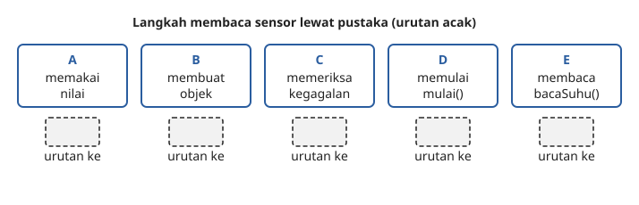

**Ingat dulu:** Tanpa melihat catatan: (1) Selama `delay(500)` berjalan, apakah papan dapat membaca tombol? Mengapa? (2) Berapa hasil `7 / 2` dan `7.0 / 2` dalam C++, dan mengapa berbeda?

1. ______
2. ______



`[Gambar: lima kartu berlabel A sampai E dalam urutan acak: A memakai nilai, B membuat objek, C memeriksa kegagalan, D memulai (mulai()), E membaca (bacaSuhu()). Di bawah tiap kartu ada kotak kosong "urutan ke" untuk ditulis nomor 1 sampai 5.]`

**Prediksi:** Sensor melaporkan suhu 30,0, dan program menghitung `float f = suhu * (9 / 5) + 32;` lalu mencetak `f`. (1) Berapa nilai `f` yang tercetak? ______ (2) Berapa seharusnya, dengan F = C x 9 / 5 + 32? ______ (3) Berapa kali sensor dibaca dalam 10 detik dengan `delay(2000)`? ______

**Lengkapi:** `loop()` mencetak suhu dengan satu angka di belakang koma dan menolak pembacaan gagal.

```arduino setengah-jadi
void loop() {
  float suhu = sensor.bacaSuhu();
  if (____(suhu)) {
    Serial.println("Gagal membaca sensor");
  } else {
    Serial.print(suhu, ____);
    Serial.println(" C");
  }
  delay(____);
}
```

**Susun:** Beri nomor urutan yang benar pada kartu di gambar. Urutan huruf: ______

**Latihan:**

1. `AI: boleh` Tulis pseudocode lalu programnya: baca suhu dan kelembapan tiap 2 detik, cetak "Suhu ruang: ... C", dan tambahkan kata "lembap" bila kelembapan lebih dari 70 persen. ______
2. `AI: tanpa AI` Ubah 25 derajat Celsius ke Fahrenheit. Lalu ubah 0 derajat Celsius ke Kelvin dengan K = C + 273,15. ______
3. Program menyimpan `int lembap = sensor.bacaLembap();` dan pembacaannya 60,5. Berapa yang tersimpan, dan kapan ini penting? ______
4. Tulis syarat: suhu antara 20 dan 30 derajat (termasuk batas) **dan** kelembapan kurang dari 70 persen. ______

**Cek diri:**

- [ ] Saya memeriksa kegagalan baca dengan `isnan()` sebelum memakai nilai.
- [ ] Saya mengubah Celsius ke Fahrenheit tanpa jebakan pembagian bilangan bulat.

**Catatan cetak (untuk guru, tidak dicetak):** satu halaman A4. Kunci ada di modul `c-x2-m2` bagian "Kunci dan petunjuk". Lembar tidak memuat kolom identitas.
