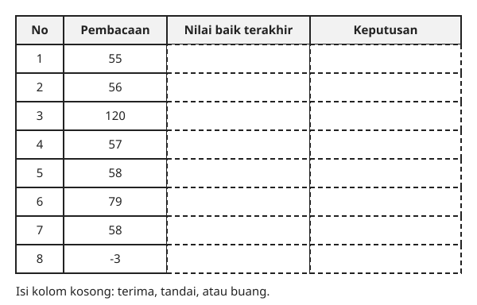

**Ingat dulu:** Tanpa melihat catatan, jawab. (1) Apa arti `isnan(suhu)` bernilai benar, dan mengapa nilai itu tidak boleh langsung dicetak sebagai suhu? ______ (2) Sebutkan tiga jenis galat beserta satu gejala masing-masing. ______



`[Gambar: tabel dengan empat kolom: No, Pembacaan, Nilai baik terakhir, dan Keputusan. Kolom No dan Pembacaan berisi 55, 56, 120, 57, 58, 79, 58, dan -3. Dua kolom lain kosong; kamu isi dengan nilai baik terakhir sebelum pembacaan itu, lalu keputusan terima, tandai, atau buang.]`

**Prediksi:** Aturan: kelembapan harus antara 0 dan 100 persen; bila selisih dengan **nilai baik terakhir** lebih dari 10, pembacaan ditandai sebagai lonjakan dan tidak diterima. Tebak dulu, tulis jawabanmu, baru telusuri dengan tabel pada gambar.

1. Pembacaan mana yang dibuang dan mana yang ditandai? ______
2. Berapa pembacaan yang tersisa sebagai data bersih? ______
3. Mengapa 79 ditandai, bukan langsung dibuang? ______

**Lengkapi:** Dua fungsi pemeriksa dengan batas sebagai parameter. Isi bagian `____`.

```cpp setengah-jadi
#include <cmath>

bool dalamRentang(float x, float terendah, float tertinggi) {
  return !std::isnan(x) && x >= ____ && x <= ____;
}

bool lonjakan(float x, float terakhirBaik, float batas) {
  return std::fabs(x - ____) > ____;
}
```

**Susun:** Urutkan baris menjadi potongan keputusan untuk satu pembacaan `x`.

```text
(a)   } else {
(b)     keputusan = "terima";
(c)   if (!dalamRentang(x)) {
(d)     keputusan = "buang";
(e)   }
```

Urutan: ______ ______ ______ ______ ______

**Latihan:**

1. `AI: tanpa AI` Data suhu 27,0; 27,2; 40,5; 27,3; 27,4 dengan rentang -10 sampai 50 dan batas lonjakan 3,0. Tulis keputusan tiap pembacaan dan jumlah data bersih. ______
2. `AI: tanpa AI` Pembacaannya 28, 28, 35, 35, 35, 35. Dengan aturan di atas, apa yang terjadi pada keempat angka 35, dan bagaimana kamu mengubah aturan agar perubahan nyata tidak terus ditolak? ______
3. `AI: boleh` Tulis tiga langkah memeriksa sensormu terhadap alat acuan, termasuk selisih yang kamu terima dan dasarnya. ______

**Cek diri:**

- [ ] Saya dapat membedakan nilai di luar rentang, data hilang, derau, dan lonjakan palsu.
- [ ] Saya membandingkan dengan nilai baik terakhir, bukan pembacaan mentah sebelumnya.
- [ ] Saya mencatat alasan setiap data yang dibuang atau ditandai.

**Catatan cetak (untuk guru, tidak dicetak):** dua halaman A4 bila kode dicetak penuh. Kunci ada di modul `c-x2-m3`, bagian "Kunci dan petunjuk". Lembar tidak memuat kolom identitas.
