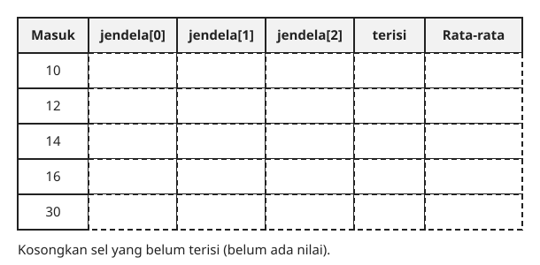

**Ingat dulu:** Tanpa melihat catatan, jawab. (1) Tulis `for` yang menghitung mundur dari 5 sampai 1. ______ (2) Tulis `dalamRentang` untuk nilai 0 sampai 100 memakai `&&`. ______



`[Gambar: tabel enam kolom: Masuk, jendela[0], jendela[1], jendela[2], terisi, dan Rata-rata. Kolom Masuk berisi 10, 12, 14, 16, dan 30. Semua kolom lain kosong; kamu isi isi jendela, jumlah elemen terisi, dan rata-ratanya setelah tiap pembacaan masuk.]`

**Prediksi:** Rata-rata bergerak 3 pembacaan terakhir: rata-rata dari **paling banyak** tiga pembacaan terbaru. Pembacaan masuk berurutan 10, 12, 14, 16, 30. Tebak dulu, tulis jawabanmu, baru telusuri dengan tabel pada gambar.

1. Tulis rata-rata setelah tiap pembacaan masuk. ______
2. Pembacaan terakhir (30) melompat jauh. Berapa kenaikan rata-ratanya dibanding rata-rata sebelumnya? ______
3. Mengapa dua rata-rata pertama dihitung dari kurang dari tiga pembacaan? ______

**Lengkapi:** `rataRata()` yang menjumlahkan hanya elemen yang sudah terisi. Isi bagian `____`.

```arduino setengah-jadi
float rataRata() {
  if (terisi == 0) {
    return NAN;
  }
  float jumlah = 0.0f;
  for (int i = 0; i < ____; i++) {
    jumlah += jendela[____];
  }
  return jumlah / ____;
}
```

**Susun:** Urutkan baris menjadi bagian `else` dari `tambah()` untuk jendela yang sudah penuh.

```text
(a)     jendela[N - 1] = x;
(b)     }
(c)     for (int i = 0; i < N - 1; i++) {
(d)       jendela[i] = jendela[i + 1];
```

Urutan: ______ ______ ______ ______

**Latihan:**

1. `AI: tanpa AI` Jendela berukuran 3 dan data 6, 9, 3, 12. Tulis isi jendela dan rata-rata setelah tiap pembacaan.

| Masuk | Isi jendela | Rata-rata |
| --- | --- | --- |
| 6 | | |
| 9 | | |
| 3 | | |
| 12 | | |

2. `AI: tanpa AI` `rataRata()` memakai `jumlah / N` selalu. Data masuk 10 lalu 20. Berapa hasil yang dicetak, berapa seharusnya, dan bagaimana memperbaikinya? ______
3. `AI: boleh` Bandingkan jendela berukuran 2 dan 10. Mana yang lebih halus, mana yang lebih cepat mengikuti perubahan nyata, dan untuk keperluan apa kamu memilih masing-masing? ______

**Cek diri:**

- [ ] Saya menghitung rata-rata dengan membagi `terisi`, bukan `N`.
- [ ] Saya dapat menelusuri rata-rata bergerak pada data kecil.
- [ ] Saya menghindari indeks di luar larik.

**Catatan cetak (untuk guru, tidak dicetak):** dua halaman A4. Kunci ada di modul `c-x2-m4`, bagian "Kunci dan petunjuk". Lembar tidak memuat kolom identitas.
