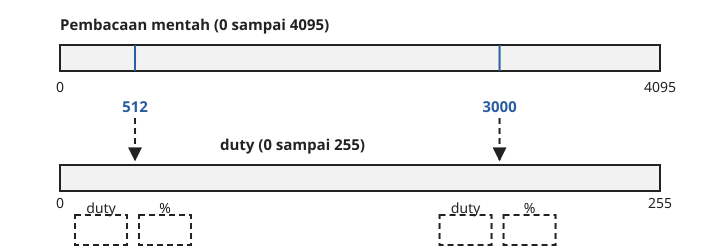

**Ingat dulu:** Tanpa melihat catatan, jawab. (1) Mengapa ambang cahaya harus ditentukan dari pengukuran rangkaianmu sendiri, bukan ditebak? ______ (2) Berapa rata-rata bergerak 3 pembacaan terakhir dari 10, 12, 20? ______



`[Gambar: dua batang skala. Batang atas bernilai 0 sampai 4095 dengan tanda pada 512 dan 3000. Batang bawah bernilai 0 sampai 255. Dari tiap tanda atas, panah putus-putus menuju kotak kosong berlabel duty dan persen. Kamu isi kotak itu.]`

**Prediksi:** Program mengatur LED dengan `duty = map(mentah, 0, 4095, 0, 255)` memakai bilangan bulat. Dua pembacaan: 512 dan 3000. Tebak dulu, tulis jawabanmu, baru telusuri.

1. Berapa nilai `duty` tiap pembacaan (dibulatkan ke bawah)? ______
2. Kira-kira berapa persen waktu LED menyala pada tiap pembacaan, yaitu `duty` dibagi 255? ______
3. Mengapa LED tampak redup atau terang tetap, bukan berkedip? ______

**Lengkapi:** Potensiometer di `PIN_POT` mengatur LED di `PIN_LED` dengan batas 0 sampai 4095. Isi bagian `____`.

```arduino setengah-jadi
void loop() {
  int mentah = analogRead(PIN_POT);
  int duty = map(mentah, 0, ____, 0, ____);
  analogWrite(____, duty);
  delay(20);
}
```

**Susun:** Urutkan baris menjadi `loop()` yang mengatur LED dari potensiometer.

```text
(a)   analogWrite(PIN_LED, duty);
(b)   int duty = map(mentah, 0, 4095, 0, 255);
(c)   int mentah = analogRead(PIN_POT);
(d) void loop() {
(e)   delay(20);
(f) }
```

Urutan: ______ ______ ______ ______ ______ ______

**Latihan:**

1. `AI: tanpa AI` Berapa `map(1000, 0, 4095, 0, 255)` dengan bilangan bulat, dan berapa persen duty-nya (duty x 100 / 255, bilangan bulat)? ______
2. `AI: tanpa AI` Program menulis `analogWrite(PIN_LED, analogRead(PIN_POT));`. Mengapa LED terang penuh untuk sebagian besar putaran potensiometer? ______
3. `AI: boleh` Tiga pembacaan potensiometer: 1000, 1030, 1010. Berapa rata-rata bergerak tiganya (satu angka di belakang koma), dan mengapa menghaluskan sebelum `map()` membantu? ______

**Cek diri:**

- [ ] Saya dapat menjelaskan duty cycle dengan kata-kataku sendiri.
- [ ] Saya dapat menghitung `map()` dengan bilangan bulat.
- [ ] Saya mengukur batas potensiometer, bukan menebaknya.

**Catatan cetak (untuk guru, tidak dicetak):** dua halaman A4. Kunci ada di modul `c-x2-m5`, bagian "Kunci dan petunjuk". Lembar tidak memuat kolom identitas.
