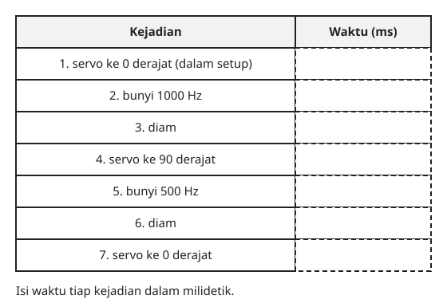

**Ingat dulu:** Tanpa melihat catatan, jawab. (1) Mengapa memecah program menjadi fungsi memudahkan pengujian? ______ (2) Berapa `map(2048, 0, 4095, 0, 255)` dengan aturan bilangan bulat? ______



`[Gambar: tabel dua kolom: Kejadian dan Waktu (ms). Kolom Kejadian berisi urutan tujuh kejadian: servo ke 0 derajat, bunyi 1000 Hz, diam, servo ke 90 derajat, bunyi 500 Hz, diam, servo ke 0 derajat. Kolom Waktu kosong dan kamu isi.]`

**Prediksi:** Palang hanya bisa bergerak sampai 90 derajat. Tebak dulu, tulis jawabanmu, baru telusuri.

```arduino setengah-jadi
void setup() {
  servo.attach(13);
  servo.write(0);
}

void loop() {
  servo.write(90);
  delay(2000);
  servo.write(0);
  delay(2000);
}
```

1. Berapa derajat total yang ditempuh lengan dalam satu putaran `loop()` (naik dan turun)? ______
2. Berapa detik satu putaran `loop()`, bila waktu gerak servo diabaikan? ______
3. Apa yang kemungkinan terjadi bila `servo.write(90)` diganti `servo.write(150)`? ______

**Lengkapi:** Fungsi `bunyi` membunyikan nada pada frekuensi tertentu selama waktu tertentu, lalu mendiamkannya. Isi bagian `____`.

```arduino setengah-jadi
void bunyi(int frekuensi, int lama_ms) {
  ledcWriteTone(PIN_BUZZER, ____);
  delay(____);
  ledcWriteTone(PIN_BUZZER, ____);
}
```

**Susun:** Urutkan baris menjadi `batasiSudut()` yang hanya menjepit batas atas.

```text
(a)   return sudut;
(b)   if (sudut > SUDUT_BUKA) {
(c) int batasiSudut(int sudut) {
(d)     return SUDUT_BUKA;
(e)   }
(f) }
```

Urutan: ______ ______ ______ ______ ______ ______

**Latihan:**

1. `AI: tanpa AI` Potongan berikut dijalankan sesudah `setup()` yang menutup palang dengan `GERAK_MS` bernilai 500. Isi kolom waktu pada gambar. Pada milidetik berapa `servo.write(90)` dipanggil, dan pada milidetik berapa palang kembali ke 0? ______

```arduino setengah-jadi
void geser(int sudut) {
  servo.write(batasiSudut(sudut));
  delay(GERAK_MS);
}

void siklusPalang() {
  bunyi(1000, 200);
  geser(SUDUT_BUKA);
  delay(2000);
  bunyi(500, 200);
  geser(SUDUT_TUTUP);
}
```

2. `AI: tanpa AI` Tulis hasil yang diharapkan sebelum menjalankan: `batasiSudut(-1)` ______, `batasiSudut(0)` ______, `batasiSudut(90)` ______, `batasiSudut(91)` ______.
3. `AI: boleh` Sudut servo diatur dari potensiometer: `map(mentah, 40, 4050, 0, 90)`. Berapa sudut untuk pembacaan 2045 (bilangan bulat)? ______

**Cek diri:**

- [ ] Saya dapat memberi servo sudut tujuan dan menjelaskan mengapa perlu menunggu geraknya.
- [ ] Saya dapat membedakan buzzer aktif dan pasif.
- [ ] Saya tahu aturan keselamatan untuk bagian yang bergerak.

**Catatan cetak (untuk guru, tidak dicetak):** dua halaman A4. Kunci ada di modul `c-x2-m6`, bagian "Kunci dan petunjuk". Lembar tidak memuat kolom identitas.
