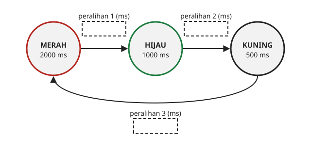

**Ingat dulu:** Tanpa melihat catatan, jawab. (1) Apa beda "papan tiruan lolos uji" dan "rangkaian saya bekerja"? ______ (2) Mengapa sudut servo dibatasi sebelum dikirim ke `write`? ______



`[Gambar: tiga lingkaran bernama MERAH (2000 ms), HIJAU (1000 ms), dan KUNING (500 ms), dihubungkan panah berurutan MERAH ke HIJAU, HIJAU ke KUNING, KUNING ke MERAH. Dekat tiga panah pertama ada kotak kosong berlabel "waktu ms"; kamu isi waktu peralihan pertama, kedua, dan ketiga, dihitung dari 0 ms saat MERAH menyala.]`

**Prediksi:** Tebak dulu, tulis jawabanmu, baru telusuri. Tombol memakai `INPUT_PULLUP`.

```arduino
// Arduino-C++ untuk ESP32. Diperiksa check:module-code terhadap header tiruan (sintaks dan tipe saja, bukan bukti perilaku papan).
const int PIN_LED = 2;
const int PIN_TOMBOL = 15;

void setup() {
  Serial.begin(115200);
  pinMode(PIN_LED, OUTPUT);
  pinMode(PIN_TOMBOL, INPUT_PULLUP);
}

void loop() {
  digitalWrite(PIN_LED, HIGH);
  delay(1000);
  digitalWrite(PIN_LED, LOW);
  delay(1000);
  if (digitalRead(PIN_TOMBOL) == LOW) {
    Serial.println("tombol");
  }
}
```

1. Tombol ditekan 100 ms tepat setelah LED menyala, lalu dilepas. Apakah "tombol" tercetak? ______
2. Berapa lama paling lama tombol harus ditahan agar pasti terbaca? ______
3. Menurutmu, apa penyebabnya? ______

**Lengkapi:** `loop()` yang berpindah keadaan bila waktu tinggal habis. Isi bagian `____`.

```arduino setengah-jadi
void loop() {
  unsigned long sekarang = ____();
  if (sekarang - ____ >= DURASI_MS[keadaan]) {
    keadaan = berikutnya(keadaan);
    ____ = sekarang;
    tampilkan();
  }
}
```

**Susun:** Urutkan baris menjadi `loop()` mesin keadaan lampu lalu lintas.

```text
(a)   mulai = sekarang;
(b)   if (sekarang - mulai >= DURASI_MS[keadaan]) {
(c)     keadaan = berikutnya(keadaan);
(d) void loop() {
(e)   unsigned long sekarang = millis();
(f)   }
(g) }
```

Urutan: ______ ______ ______ ______ ______ ______ ______

**Latihan:**

1. `AI: tanpa AI` Durasi MERAH 2000, HIJAU 1000, KUNING 500 (milidetik), dan `loop()` dicek tiap 100 ms. Isi waktu tiap peralihan pada gambar, lalu tulis keadaan pada 4000 ms. ______
2. `AI: tanpa AI` Seorang murid menulis `if (sekarang >= mulai + DURASI)`. Dengan penghitung 32 bit, `mulai` bernilai 4294967000 dan `DURASI` 1000, hitung `mulai + DURASI` dan jelaskan apa yang terjadi bila `sekarang` bernilai 4294967100. ______
3. `AI: boleh` Gambar atau tulis tabel keadaan (keadaan, LED menyala, lama tinggal, berikutnya) untuk lampu lalu lintas mini tanpa `delay`: MERAH 5 detik, HIJAU 4 detik, KUNING 1 detik. ______

**Cek diri:**

- [ ] Saya dapat menjelaskan mengapa `delay()` membuat program tidak tanggap.
- [ ] Saya menulis selang waktu dengan `sekarang - mulai >= durasi`.
- [ ] Saya dapat menggambar diagram keadaan dan menerjemahkannya ke `enum`.

**Catatan cetak (untuk guru, tidak dicetak):** dua halaman A4. Kunci ada di modul `c-x2-m7`, bagian "Kunci dan petunjuk". Lembar tidak memuat kolom identitas.
