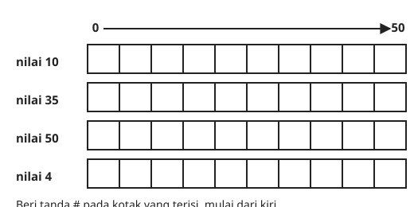

**Ingat dulu:** Tanpa melihat catatan, jawab. (1) Tulis syarat `millis()` yang benar untuk "sudah lewat 500 ms sejak `mulai`". ______ (2) Apa arti duty 50 persen pada PWM, dan mengapa LED tampak redup, bukan berkedip? ______



`[Gambar: skala sepuluh kotak dari 0 di kiri sampai 50 di kanan. Di bawahnya ada empat baris berlabel nilai 10, 35, 50, dan 4, masing-masing sepuluh kotak kosong. Kamu menandai satu tanda # di tiap kotak yang terisi menurut rumus.]`

**Prediksi:** Grafik teks menggambar satu batang `#` untuk tiap nilai. Panjangnya `(nilai - minimum) * lebar / (maksimum - minimum)` dengan bilangan bulat (dibulatkan ke bawah). Rentang 0 sampai 50, lebar 10 `#`. Tebak dulu, tulis jawabanmu, baru telusuri.

1. Berapa `#` untuk nilai 10, 35, dan 50? Gambar pada kotak di atas. ______
2. Berapa `#` untuk nilai 4? Mengapa tidak ada `#` sama sekali walau nilainya bukan nol? ______
3. Apa yang terjadi bila nilainya 60? ______

**Lengkapi:** Fungsi ini mengirim baris plotter dengan dua nama deret: `suhu` dan `ambang`. Isi bagian `____`.

```arduino setengah-jadi
void cetakPlotter(float suhu, float ambang) {
  Serial.print("____:");
  Serial.print(suhu, 1);
  Serial.print(",____:");
  Serial.print(ambang, 1);
  Serial.println();
}
```

**Susun:** Urutkan baris menjadi `loop()` yang mencetak satu titik tiap `SELANG_MS`.

```text
(a)     mulai = millis();
(b) }
(c) void loop() {
(d)   }
(e)     cetakPlotter(suhuDariMentah(analogRead(PIN_SENSOR)), AMBANG);
(f)   if (millis() - mulai >= SELANG_MS) {
```

Urutan: ______ ______ ______ ______ ______ ______

**Latihan:**

1. `AI: tanpa AI` Dengan rumus panjang batang di atas (`nilai`, `minimum`, `maksimum`, `lebar`), berapa `panjangBatang(20, 0, 50, 25)` dan `panjangBatang(7, 0, 50, 25)`? ______
2. `AI: tanpa AI` Dengan rentang 0 sampai 40 dan lebar 20, `panjangBatang(50, 0, 40, 20)` memberi 25 dan `panjangBatang(-5, 0, 40, 20)` memberi -2. Apa akibatnya pada batang, dan perbaikan apa yang mencegahnya? ______
3. `AI: boleh` Tulis pseudocode: kirim ke plotter suhu dan ambangnya tiap 500 ms tanpa `delay()`. ______

**Cek diri:**

- [ ] Saya dapat menulis satu baris plotter dengan dua deret bernama.
- [ ] Saya mencetak tiap selang waktu tanpa `delay()`.
- [ ] Saya membatasi nilai di luar rentang sebelum menghitung.

**Catatan cetak (untuk guru, tidak dicetak):** dua halaman A4. Kunci ada di modul `c-x2-m8`, bagian "Kunci dan petunjuk". Lembar tidak memuat kolom identitas.
