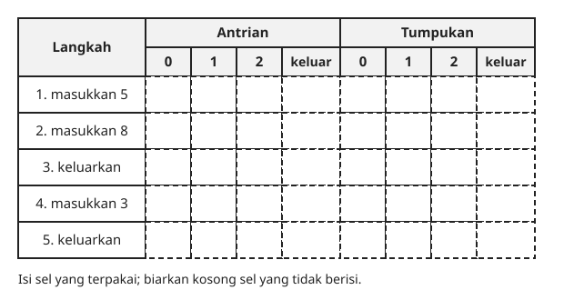

**Ingat dulu:** Tanpa melihat catatan, jawab. (1) Mengapa grafik di plotter bisa tampak melonjak padahal suhunya hanya berubah 0,4 derajat? ______ (2) Apa beda buzzer aktif dan buzzer pasif? ______



`[Gambar: tabel lima langkah (masukkan 5, masukkan 8, keluarkan satu nilai, masukkan 3, keluarkan satu nilai). Untuk antrian ada tiga sel isi (0, 1, 2) dan satu sel nilai keluar; untuk tumpukan ada tiga sel isi (0, 1, 2) dan satu sel nilai keluar. Semua sel kosong dan kamu isi.]`

**Prediksi:** Dua struktur kosong berkapasitas 3: antrian (`masuk`, `keluar`) dan tumpukan (`dorong`, `ambil`). Urutan operasinya sama: masukkan 5, masukkan 8, keluarkan satu nilai, masukkan 3, keluarkan satu nilai. Tebak dulu, tulis jawabanmu, baru telusuri dengan tabel pada gambar.

1. Dua nilai apa yang keluar dari antrian, berurutan, dan apa yang tersisa? ______
2. Dua nilai apa yang keluar dari tumpukan, berurutan, dan apa yang tersisa? ______
3. Mengapa hasilnya berbeda padahal urutan operasinya sama? ______

**Lengkapi:** `masuk` pada antrian. Isi bagian `____`.

```arduino setengah-jadi
bool masuk(int nilai) {
  if (terisi == ____) {
    hilang++;
    return ____;
  }
  antrian[____] = nilai;
  terisi++;
  return true;
}
```

**Susun:** Urutkan baris menjadi fungsi `keluar` yang benar.

```text
(a)   nilai = antrian[0];
(b) }
(c)   return true;
(d)   terisi--;
(e) bool keluar(int& nilai) {
(f)   if (terisi == 0) {
(g)     return false;
(h)   }
(i)   for (int i = 0; i < terisi - 1; i++) { antrian[i] = antrian[i + 1]; }
```

Urutan: ______ ______ ______ ______ ______ ______ ______ ______ ______

**Latihan:**

1. `AI: tanpa AI` Antrian berkapasitas 3. Pada langkah ke-t masuk pembacaan 10 x t (10, 20, 30, ...). Pada langkah 3 dan 6 satu data diproses, setelah data langkah itu masuk. Berapa data ditolak sampai akhir langkah 6, dan apa isi antrian? ______
2. `AI: tanpa AI` Seorang murid menghapus baris `if (terisi == KAPASITAS)` dari `masuk`. Apa yang terjadi saat antrian sudah penuh dan satu data lagi datang? ______
3. `AI: boleh` Tulis pseudocode tumpukan `dorong` dan `ambil` berkapasitas 5, lalu cara memakainya untuk mencetak tiga pembacaan terakhir dari yang terbaru. ______

**Cek diri:**

- [ ] Saya dapat menjelaskan FIFO dan LIFO dengan contoh sehari-hari.
- [ ] Saya menjaga keadaan penuh dan kosong.
- [ ] Saya menelusuri isi struktur tiap langkah di kertas.

**Catatan cetak (untuk guru, tidak dicetak):** dua halaman A4. Kunci ada di modul `c-x2-m9`, bagian "Kunci dan petunjuk". Lembar tidak memuat kolom identitas.
