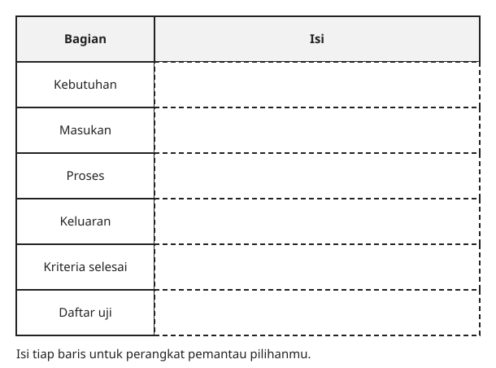

**Ingat dulu:** Tanpa melihat catatan, jawab. (1) Apa kelemahan `delay()` untuk program yang harus melakukan dua hal? ______ (2) Mengapa median tujuh pembacaan membuang lonjakan tunggal, sedangkan rata-rata tidak? ______



`[Gambar: tabel dua kolom: Bagian dan Isi. Kolom Bagian berisi enam baris: Kebutuhan, Masukan, Proses, Keluaran, Kriteria selesai, dan Daftar uji. Kolom Isi kosong dan kamu isi untuk perangkat pemantau pilihanmu.]`

**Prediksi:** Sebuah tim ingin membuat pemantau suhu untuk ruang penyimpanan alat peraga. Empat kalimat kebutuhan diusulkan. Tebak dulu, tulis jawabanmu.

- (a) "Pemantau harus bekerja dengan baik."
- (b) "Alarm berbunyi bila suhu di atas 30 derajat Celsius pada 3 pembacaan berturut-turut."
- (c) "Pembacaan dilakukan tiap 10 detik."
- (d) "Alarm harus cepat."

1. Kalimat mana yang dapat diuji dengan jawaban "lulus" atau "gagal" yang jelas? ______
2. Untuk kalimat (b), `perluAlarm` mengembalikan benar bila ada 3 pembacaan berturut-turut di atas 30. Apa hasilnya pada urutan 29, 31, 32, 33 dan pada urutan 31, 32, 29, 33, 34? ______
3. Mengapa 30,0 tepat tidak membuat alarm berbunyi menurut kalimat (b)? ______

**Lengkapi:** Kebutuhan baru: "Siaga bila kelembapan di atas 70 persen pada 2 pembacaan berturut-turut." Isi bagian `____`.

```cpp setengah-jadi
bool perluSiaga(const double lembap[], int jumlah) {
  int beruntun = 0;
  for (int i = 0; i < jumlah; i++) {
    if (lembap[i] ____ 70.0) {
      beruntun++;
    } else {
      beruntun = ____;
    }
    if (beruntun >= ____) {
      return true;
    }
  }
  return false;
}
```

**Susun:** Urutkan baris menjadi isi perulangan `perluAlarm`.

```text
(a)     if (beruntun >= minimalBerturut) {
(b)       beruntun = 0;
(c)     }
(d)     if (suhu[i] > batas) {
(e)       beruntun++;
(f)     } else {
(g)       return true;
(h)     }
```

Urutan: ______ ______ ______ ______ ______ ______ ______ ______

**Latihan:**

1. `AI: tanpa AI` Dari empat kalimat pada Prediksi, tulis ulang yang tidak dapat diuji menjadi kalimat yang dapat diuji. ______
2. `AI: tanpa AI` Berapa hasil `perluAlarm` pada 35, 35, 35 dengan batas 30 dan minimal 3? Pada 31, 29, 31, 29, 31? ______
3. `AI: boleh` Isi lembar rancangan pada gambar untuk perangkat pemantau pilihanmu (misalnya suhu ruang penyimpanan atau cahaya kelas). ______

**Cek diri:**

- [ ] Saya dapat menyebut empat tahap proses rekayasa produk dan isi tiap tahap.
- [ ] Saya dapat menulis kebutuhan dengan angka, satuan, dan kondisi.
- [ ] Saya menyertakan kasus tepat di batas pada daftar ujiku.

**Catatan cetak (untuk guru, tidak dicetak):** dua halaman A4. Kunci ada di modul `c-xi1-m1`, bagian "Kunci dan petunjuk". Lembar tidak memuat kolom identitas.
