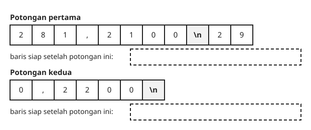

**Ingat dulu:** Tanpa melihat catatan, jawab. (1) Bila penyangga penuh dan data baru datang, apa yang dilakukan penyangga melingkar pada modul `c-xi1-m9`, dan apa harganya? ______ (2) Mengapa kecepatan (baud) di program dan di monitor serial harus sama? ______



`[Gambar: dua deret kotak karakter. Potongan pertama berisi 2, 8, 1, koma, 2, 1, 0, 0, \n, 2, 9. Potongan kedua berisi 0, koma, 2, 2, 0, 0, \n. Di bawah tiap potongan ada kotak kosong berlabel "baris siap setelah potongan ini"; kamu isi.]`

**Prediksi:** Papan A mengirim pesan berbentuk `suhu10,cahaya` diakhiri `\n`, dengan `suhu10` suhu dikali 10 (281 berarti 28,1 derajat). Penerima mengumpulkan karakter sampai `\n`. Data tiba **terpotong** karena aliran tidak peduli batas pesan, seperti pada gambar. Tebak dulu, tulis jawabanmu, baru telusuri.

1. Berapa baris yang siap setelah potongan pertama, dan apa isinya? ______
2. Apa isi baris yang siap setelah potongan kedua? ______
3. Bila `\n` tidak pernah datang, apa yang terjadi pada penerima yang tidak menjaga panjang baris? ______

**Lengkapi:** `terima` yang mengabaikan `\r`, menolak baris terlalu panjang, dan menandai baris siap saat `\n`. Bagian `____` ada pada tiga tempat.

```cpp setengah-jadi
const int PANJANG_MAKS = 16;

struct Penerima {
  char baris[PANJANG_MAKS];
  int panjang;
  bool kepanjangan;
};

bool terima(Penerima& r, char c) {  // true bila satu baris utuh siap
  if (c == '____') {
    return false;
  }
  if (c != '____') {
    if (r.panjang < ____ - 1) {
      r.baris[r.panjang++] = c;
    } else {
      r.kepanjangan = true;
    }
    return false;
  }
  r.baris[r.panjang] = '\0';
  r.panjang = 0;
  bool sah = !r.kepanjangan;
  r.kepanjangan = false;
  return sah;
}
```

**Susun:** Urutkan baris menjadi bagian pengirim `loop`: tiap `SELANG_MS`, kirim `suhu10`, koma, lalu `cahaya` dan akhir baris.

```text
(a)     int cahaya = analogRead(PIN_CAHAYA);
(b) void loop() {
(c)     Serial2.print(',');
(d)     mulai += SELANG_MS;
(e)     Serial2.print(suhu10);
(f)   if (millis() - mulai >= SELANG_MS) {
(g)     int suhu10 = analogRead(PIN_SUHU) * 500 / 4095;
(h)     Serial2.println(cahaya);
(i)   }
(j) }
```

Urutan: ______ ______ ______ ______ ______ ______ ______ ______ ______ ______

**Latihan:**

1. `AI: tanpa AI` Potongan `12,3\n4` lalu `5,6\n` diterima oleh penerima pada Lengkapi. Berapa baris siap setelah tiap potongan, dan apa isinya? ______
2. `AI: tanpa AI` Seorang murid membuang baris `if (c == '\r') return BELUM;` dari `terima`. Papan A memakai `println`. Apa yang terjadi pada tiap baris, dan mengapa? ______
3. `AI: boleh` Tulis pseudocode fungsi `masukAkal(const Pesan&)` yang benar bila `suhu10` antara 150 dan 450 dan `cahaya` antara 0 dan 4095. Uji pada (281, 2100), (-5, 3000), dan (281, 5000). ______

**Cek diri:**

- [ ] Saya dapat menjelaskan mengapa pesan perlu batas dan memakai tanda akhir baris.
- [ ] Saya menulis penerima tanpa `delay`, dengan penyangga berukuran tetap.
- [ ] Saya menolak baris terlalu panjang atau rusak dan mencatat jumlahnya.

**Catatan cetak (untuk guru, tidak dicetak):** dua halaman A4. Kunci ada di modul `c-xi1-m10`, bagian "Kunci dan petunjuk". Lembar tidak memuat kolom identitas.
