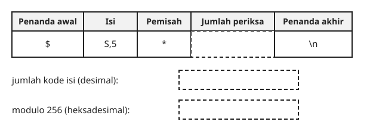

**Ingat dulu:** Tanpa melihat catatan, jawab. (1) Apa fungsi tanda akhir baris `\n` dalam pesan antar papan? ______ (2) Mengapa urutan anggota `struct` dapat mengubah `sizeof` padahal isinya sama? ______



`[Gambar: lima kotak berjajar: Penanda awal ($), Isi (S,5), Pemisah (*), Jumlah periksa (kosong), dan Penanda akhir (\n). Di bawahnya dua kotak kosong berlabel "jumlah kode (desimal)" dan "modulo 256 (heksadesimal)". Kamu mengisinya.]`

**Prediksi:** Jumlah periksa pada modul ini: jumlahkan kode ASCII tiap karakter isi, lalu ambil sisa bagi 256. Kode yang dipakai: `S` = 83, `,` = 44, `1` = 49, `2` = 50. Tebak dulu, tulis jawabanmu, baru telusuri.

1. Berapa jumlah periksa isi `S,1` dalam desimal? ______
2. Isi berubah menjadi `S,2` (satu digit berubah di jalan). Apakah jumlah periksanya berubah? ______
3. Isi `S,12` berubah menjadi `S,21` (dua digit tertukar). Apakah jumlah periksanya berubah, dan apa artinya bagi penerima? ______

**Lengkapi:** `nilaiHeks` mengubah satu karakter heksadesimal huruf besar menjadi nilainya, atau -1 bila bukan. Bagian `____` ada pada tiga tempat.

```cpp setengah-jadi
int nilaiHeks(char c) {
  if (c >= '0' && c <= '9') {
    return c - '____';
  }
  if (c >= 'A' && c <= 'F') {
    return c - 'A' + ____;
  }
  return ____;
}
```

**Susun:** Urutkan baris menjadi `jumlahPeriksa`.

```text
(a)   for (int i = 0; i < n; i++) {
(b)     jumlah = static_cast<unsigned char>(jumlah + static_cast<unsigned char>(isi[i]));
(c) unsigned char jumlahPeriksa(const char* isi, int n) {
(d)   unsigned char jumlah = 0;
(e)   return jumlah;
(f)   }
(g) }
```

Urutan: ______ ______ ______ ______ ______ ______ ______

**Latihan:**

1. `AI: tanpa AI` Berapa jumlah periksa (desimal dan heksadesimal) isi `S,5`, dan bagaimana pesan lengkapnya? (`5` adalah 53.) Isi gambar. ______
2. `AI: tanpa AI` Untuk tiap galat berikut pada isi `S,300,1500`, apakah jumlah periksa mendeteksinya: (a) satu digit berubah, (b) dua digit tertukar, (c) koma pertama bergeser satu tempat sehingga isi menjadi `S,3,001500`? ______
3. `AI: boleh` Tulis spesifikasi pesan baru dengan tiga ruas, `S,<suhu10>,<cahaya>,<nomor>`, dengan nomor urut pesan, lalu hitung pesan lengkap untuk suhu10 281, cahaya 2100, nomor 7 (kode `7` adalah 55, dan jumlah isi `S,281,2100` adalah 521). ______

**Cek diri:**

- [ ] Saya dapat menyebut bagian pesan beserta fungsinya: penanda awal, isi, jumlah periksa, penanda akhir.
- [ ] Saya dapat menghitung jumlah periksa dan menuliskannya dalam heksadesimal.
- [ ] Saya dapat menyebut galat yang tertangkap dan yang lolos jumlah periksa.

**Catatan cetak (untuk guru, tidak dicetak):** dua halaman A4. Kunci ada di modul `c-xi1-m11`, bagian "Kunci dan petunjuk". Lembar tidak memuat kolom identitas.
