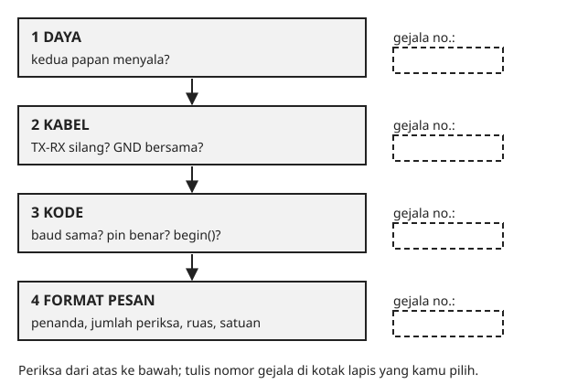

**Ingat dulu:** Tanpa melihat catatan, jawab. (1) Mengapa jumlah periksa yang cocok belum menjamin isi pesan benar? ______ (2) Mengapa mengubah satu hal pada satu waktu mempercepat penemuan galat? ______



`[Gambar: empat kotak bertumpuk dengan panah turun: 1 DAYA, 2 KABEL (TX-RX silang, GND), 3 KODE (baud, pin, begin), dan 4 FORMAT PESAN (penanda, jumlah periksa, ruas, satuan). Di samping tiap kotak ada kotak kosong "gejala no."; kamu tulis nomor gejala 1, 2, atau 3 dari Prediksi pada lapis yang kamu pilih.]`

**Prediksi:** Tiga gejala pada dua papan yang dihubungkan serial. Empat lapis diperiksa berurutan: **daya**, **kabel**, **kode**, dan **format pesan**. Tebak dulu, tulis jawabanmu, baru telusuri.

1. Penerima tidak menerima satu byte pun, dan lampu daya papan penerima padam. Lapis mana yang diperiksa pertama? ______
2. Penerima mencetak huruf acak; daya dan kabel sudah dipastikan baik. Lapis mana yang paling mungkin, dan apa yang diperiksa? ______
3. Penerima menerima pesan yang sah, tetapi semua suhu terbaca sepuluh kali lebih besar dari yang dikirim. Lapis mana, dan apa penyebab yang paling mungkin? ______

**Lengkapi:** Jurnal diagnosis memuat lima hal: gejala, pengamatan, dugaan, **satu** tindakan, dan hasil. Lengkapi untuk skenario huruf acak. Bagian `____` ada pada tiga tempat.

```text setengah-jadi
Gejala     : penerima mencetak huruf acak
Pengamatan : byteMasuk 120, bukanCetak 80
Dugaan     : lapis ____ (baud berbeda di kedua sisi)
Tindakan   : samakan ____ di penerima dengan pengirim; ubah hanya itu
Hasil      : ____ (diisi setelah dicoba)
```

**Susun:** Urutkan baris menjadi fungsi `dapatDicetak`.

```text
(a) bool dapatDicetak(int c) {
(b)   return (c >= 32 && c <= 126) || c == '\r' || c == '\n';
(c) }
```

Urutan: ______ ______ ______

**Latihan:**

1. `AI: tanpa AI` Fungsi `diagnosa` membaca hitungan `byteMasuk`, `bukanCetak`, `barisSah`, `gagalPeriksa`, dan `gagalFormat`, lalu menyebut dugaan pertama menurut urutan lapis. Ia diberi `{200, 0, 0, 0, 0}` (200 byte masuk, tidak ada baris sah, gagal periksa, atau gagal format). Apa keluarannya, mengapa itu menyesatkan, dan apa perbaikannya? ______
2. `AI: tanpa AI` Untuk tiap kasus sintetis, tulis gejala yang kamu duga akan teramati, lapis diagnosisnya, dan satu tindakan perbaikan.

| Kasus | Gejala | Lapis | Satu tindakan |
| --- | --- | --- | --- |
| (a) TX papan A disambung ke TX papan B | | | |
| (b) papan A baud 115200, papan B 9600 | | | |
| (c) papan A mengirim derajat utuh, spesifikasi meminta sepersepuluh derajat | | | |

3. `AI: boleh` Gambar diagram alir diagnosismu sendiri untuk papan B yang tidak menampilkan apa pun. Tulis tiap lapis sebagai pertanyaan ya atau tidak dan tindakan satu langkahnya. ______

**Cek diri:**

- [ ] Saya dapat menyebut empat lapis diagnosis berurutan dan alasan urutannya.
- [ ] Saya mengamati dan menghitung dulu sebelum mengubah apa pun.
- [ ] Saya mengubah satu hal pada satu waktu dan mencatat hasilnya.

**Catatan cetak (untuk guru, tidak dicetak):** dua halaman A4. Kunci ada di modul `c-xi1-m12`, bagian "Kunci dan petunjuk". Lembar tidak memuat kolom identitas.
