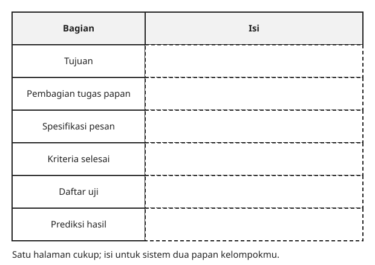

**Ingat dulu:** Tanpa melihat catatan, jawab. (1) Urutkan empat lapis diagnosis dari yang diperiksa pertama. ______ (2) Mengapa kedua papan harus berbagi GND dan memakai baud yang sama? ______

`[Gambar: tabel dua kolom: Bagian dan Isi. Kolom Bagian berisi enam baris: Tujuan, Pembagian tugas papan, Spesifikasi pesan, Kriteria selesai, Daftar uji, dan Prediksi hasil. Kolom Isi kosong dan kamu isi untuk sistem dua papan pilihan kelompokmu.]`

**Prediksi:** Pemantau suhu dengan pemanas simulasi (LED): pemanas menyala bila rata-rata `suhu10` di bawah 270, mati bila di atas 290, dan di antaranya tetap. Penyangga melingkar menyimpan lima suhu10 terakhir. Suhu10 yang masuk: 260, 262, 264, 266, 268. Apa rata-ratanya, dan apa keputusan pemanas? ______

**Lengkapi:** Tulis hasil yang diharapkan untuk tiap masukan sebelum menguji. Jumlah periksa memakai aturan `c-xi1-m11`: jumlah kode karakter isi, modulo 256, dua digit heksadesimal.

| No | Masukan | Hasil yang diharapkan |
| --- | --- | --- |
| 1 | `$S,281,2100*09` | |
| 2 | `$S,285,2160*12` | |
| 3 | `xx#$S,290,2200*0A` | |
| 4 | `$S,28` lalu pesan utuh | |
| 5 | rata-rata tepat 290 (suhu10 280, 285, 290, 295, 300) | |

**Latihan:**

1. Pemanas sedang menyala. Lima pesan sah terakhir bersuhu10 275, 280, 285, 291, 296. Berapa rata-rata (bilangan bulat, dipotong), dan apakah pemanas mati? Apa harga memakai rata-rata untuk keputusan? ______
2. Hitung jumlah periksa isi `S,290,2000` dan tulis pesan lengkapnya. ______
3. Isi lembar rencana pada gambar untuk sistem dua papan pilihan kelompokmu. ______

**Cek diri:**

- [ ] Saya menulis rencana, spesifikasi pesan, dan kriteria selesai sebelum merakit.
- [ ] Saya menguji pesan rusak, derau, terputus, tepat di batas, dan tanpa pesan.
- [ ] Saya menulis laporan satu halaman dan memberi umpan balik dalam tiga kalimat.

**Catatan cetak (untuk guru, tidak dicetak):** dua halaman A4. Kunci ada di modul `c-xi1-m13`, bagian "Kunci dan petunjuk". Bagian Susun dilewati karena modul proyek ini tidak memuat soal Parsons. Lembar tidak memuat kolom identitas.
