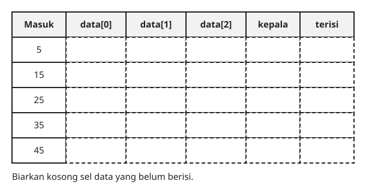

**Ingat dulu:** Tanpa melihat catatan, jawab. (1) Hitung jumlah periksa (jumlah kode karakter modulo 256) untuk isi `AB` (A = 65, B = 66). ______ (2) Pada penyangga melingkar berkapasitas 4 yang berisi 10, 20, 30, 40, nilai mana yang tertimpa saat 50 masuk? ______ (3) Urutkan empat lapis diagnosis sambungan dari yang diperiksa pertama. ______



`[Gambar: tabel enam kolom: Masuk, data[0], data[1], data[2], kepala, dan terisi. Kolom Masuk berisi 5, 15, 25, 35, dan 45. Semua kolom lain kosong; kamu isi isi larik, kepala, dan terisi setelah tiap nilai masuk.]`

**Latihan:** Kerjakan sendiri, `AI: tanpa AI`.

1. Program berikut dijalankan. Apa yang tercetak? Tulis juga isi larik `data` di memori (gunakan tabel pada gambar).

```cpp
// C++17 biasa, jalan di komputer. Diperiksa oleh check:module-code.
#include <iostream>

const int K = 3;

struct Penyangga {
  int data[K];
  int kepala;
  int terisi;
};

void tambah(Penyangga& b, int nilai) {
  if (b.terisi == K) {
    b.data[b.kepala] = nilai;
    b.kepala = (b.kepala + 1) % K;
  } else {
    b.data[(b.kepala + b.terisi) % K] = nilai;
    b.terisi++;
  }
}

int main() {
  Penyangga b = {};
  const int masuk[] = {5, 15, 25, 35, 45};
  for (int v : masuk) {
    tambah(b, v);
  }
  for (int i = 0; i < b.terisi; i++) {
    std::cout << b.data[(b.kepala + i) % K] << " ";
  }
  std::cout << "| kepala " << b.kepala << "\n";
}
```

2. (a) Jumlah periksa isi `S,7,9` dalam desimal dan heksadesimal (`S` = 83, `,` = 44, `7` = 55, `9` = 57). ______ (b) Satu pembacaan berisi `uint32_t detik`, `int16_t suhu10`, dan `int16_t cahaya` tanpa anggota lain (8 byte): berapa byte untuk 50 pembacaan? ______ (c) Histeresis dengan batas nyala 1900 dan batas mati 2100, lampu awalnya mati: tulis keadaan lampu (nyala atau mati) untuk pembacaan 2200, 2050, 1950, 1850, 1950, 2050, 2150, dan berapa kali ia berganti. ______
3. Tulis lapis yang diperiksa pertama dan satu tindakannya untuk tiap kasus: (a) papan penerima tidak menampilkan apa pun dan lampu dayanya padam; (b) penerima menerima banyak baris, tetapi hitungan `gagalPeriksa` mendekati jumlah semua baris dan `barisSah` 0. ______

**Cek diri:**

- [ ] Saya dapat menelusuri penyangga melingkar dan menyebut isi larik di memori.
- [ ] Saya dapat menghitung memori `struct` dan jumlah periksa.
- [ ] Saya dapat menyebut empat lapis diagnosis dan mengubah satu hal pada satu waktu.

**Catatan cetak (untuk guru, tidak dicetak):** dua halaman A4. Kunci ada di modul `c-xi1-m14`, bagian "Kunci dan petunjuk". Bagian Prediksi, Lengkapi, dan Susun dilewati karena modul asesmen ini tidak memuat bahan untuk ketiganya. Lembar tidak memuat kolom identitas.
