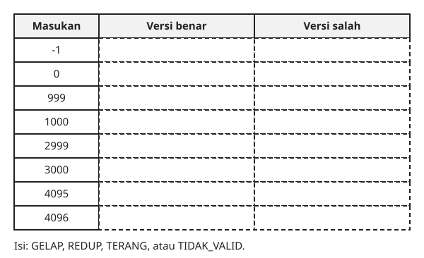

**Ingat dulu:** Tanpa melihat catatan, jawab. (1) Mengapa kriteria selesai harus bisa diuji, dan apa yang salah dengan "perangkat harus bekerja dengan baik"? ______ (2) Tulis satu kasus uji untuk `median` yang semua nilainya sama, dan hasil yang kamu harapkan. ______



`[Gambar: tabel tiga kolom: Masukan, Versi benar, dan Versi salah. Kolom Masukan berisi -1, 0, 999, 1000, 2999, 3000, 4095, dan 4096. Dua kolom lain kosong; kamu isi dengan GELAP, REDUP, TERANG, atau TIDAK_VALID.]`

**Prediksi:** `kategoriCahaya` mengubah pembacaan mentah 0 sampai 4095 menjadi `GELAP` (di bawah 1000), `REDUP` (1000 sampai 2999), atau `TERANG` (3000 ke atas); di luar 0 sampai 4095 hasilnya `TIDAK_VALID`. Versi salah menulis `<=` di tempat `<` pada batas gelap. Tebak dulu, tulis jawabanmu, baru isi tabel.

1. Versi benar: berapa dari delapan uji yang lulus? ______
2. Versi salah: masukan mana yang gagal, dan apa hasil yang dikembalikannya? ______
3. Mengapa uji dengan masukan 500 dan 2000 saja tidak akan menemukan galat itu? ______

**Lengkapi:** `suhuValid` menerima 15,0 sampai 45,0 derajat Celsius (kedua ujung termasuk). Lengkapi data uji supaya mencakup kedua batas: pilih nilai tepat di batas dan hasil yang diharapkan.

```cpp setengah-jadi
bool suhuValid(double c) { return c >= 15.0 && c <= 45.0; }

const double MASUKAN[] = {14.9, ____, 15.1, 44.9, ____, 45.1};
const bool HARAPAN[] = {false, true, true, true, ____, false};
```

**Susun:** Urutkan baris menjadi isi `jalankanUji`.

```text
(a)   int gagal = 0;
(b)   return gagal;
(c)   for (int i = 0; i < JUMLAH_UJI; i++) {
(d)     if (std::strcmp(hasil, HARAPAN[i]) != 0) {
(e)       gagal++;
(f)     }
(g)     const char* hasil = fungsi(MASUKAN[i]);
(h)   }
```

Urutan: ______ ______ ______ ______ ______ ______ ______ ______

**Latihan:**

1. `AI: tanpa AI` Laporan uji menunjukkan hanya masukan 3000 yang gagal, dengan hasil `REDUP` padahal harapannya `TERANG`. Operator mana pada `kategoriCahaya` yang salah? ______
2. `AI: tanpa AI` Tulis ulang `if (a > 2999) x = 1;` sehingga tujuannya jelas, dengan nama dan konstanta bernama. ______
3. `AI: boleh` Fungsi `persenDariMentah(int mentah)` mengembalikan `mentah * 100 / 4095` untuk 0 sampai 4095 dan -1 di luar itu. Tulis dulu daftar kasus uji (masukan dan hasil), baru fungsinya. ______

**Cek diri:**

- [ ] Saya selalu menguji satu di bawah, tepat di, dan satu di atas setiap batas.
- [ ] Saya memakai konstanta bernama, bukan angka ajaib.
- [ ] Saya memutuskan hasil harapan sebelum menjalankan program.

**Catatan cetak (untuk guru, tidak dicetak):** dua halaman A4. Kunci ada di modul `c-xi1-m2`, bagian "Kunci dan petunjuk". Lembar tidak memuat kolom identitas.
