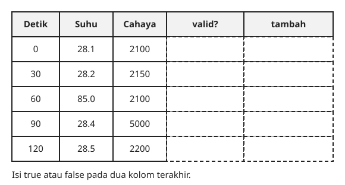

**Ingat dulu:** Tanpa melihat catatan, jawab. (1) Mengapa larik dan penghitung `terisi` yang selalu dipakai bersama sebaiknya disatukan dalam satu tipe? ______ (2) Berapa indeks elemen pertama dan terakhir pada larik berisi 5 elemen? ______



`[Gambar: tabel lima kolom: Detik, Suhu, Cahaya, valid?, dan tambah. Lima baris berisi pembacaan (0; 28,1; 2100), (30; 28,2; 2150), (60; 85,0; 2100), (90; 28,4; 5000), dan (120; 28,5; 2200). Kolom valid? dan tambah kosong; kamu isi true atau false.]`

**Prediksi:** Lima pembacaan karangan dimasukkan berurutan ke penyangga berkapasitas 4. Satu pembacaan **valid** bila suhu antara 15,0 dan 45,0 dan cahaya antara 0 dan 4095. Tebak dulu, tulis jawabanmu, baru isi tabel pada gambar.

1. Berapa dari empat pembacaan yang tersimpan berstatus valid? ______
2. Apa yang dikembalikan `tambah` untuk pembacaan kelima, dan apa yang terjadi pada isi penyangga? ______
3. Mengapa pembacaan pada detik 60 dan 90 tetap disimpan walaupun tidak valid? ______

**Lengkapi:** Kasus uji disatukan dalam satu `struct` sehingga masukan dan harapan tidak mungkin bergeser. Isi bagian `____`.

```cpp setengah-jadi
#include <iostream>

struct KasusUji {
  ____ masukan;
  const char* ____;
};

const KasusUji DAFTAR[] = {{999, "GELAP"}, {1000, "REDUP"}};

int main() {
  std::cout << DAFTAR[1].____ << "\n";
}
```

**Susun:** Urutkan baris menjadi fungsi `tambah`.

```text
(a)   b.data[b.terisi] = p;
(b)   return true;
(c) bool tambah(Penyangga& b, const Pembacaan& p) {
(d)   if (b.terisi >= KAPASITAS) {
(e)     return false;
(f)   }
(g)   b.terisi++;
(h) }
```

Urutan: ______ ______ ______ ______ ______ ______ ______ ______

**Latihan:**

1. `AI: tanpa AI` Pada `Penyangga b;` (tanpa `= {}`), `terisi` tidak diberi nilai. Apa risikonya saat `tambah(b, p)` dipanggil pertama kali? ______
2. `AI: tanpa AI` Tulis `struct` untuk satu pembacaan sensor jarak: waktunya, jaraknya dalam sentimeter, dan apakah valid. Pilih tipe yang tepat untuk tiap anggota. ______
3. `AI: boleh` Tulis pseudocode fungsi `suhuTertinggi(const Pembacaan data[], int jumlah)` yang mengembalikan suhu tertinggi di antara pembacaan yang **valid**, atau -1 bila tidak ada satu pun yang valid. ______

**Cek diri:**

- [ ] Saya dapat menulis `struct` dan membaca anggotanya dengan tanda titik.
- [ ] Saya selalu memberi nilai awal pada `struct` yang berisi penghitung.
- [ ] Saya dapat menggantikan dua larik sejajar dengan satu larik `struct`.

**Catatan cetak (untuk guru, tidak dicetak):** dua halaman A4. Kunci ada di modul `c-xi1-m3`, bagian "Kunci dan petunjuk". Lembar tidak memuat kolom identitas.
