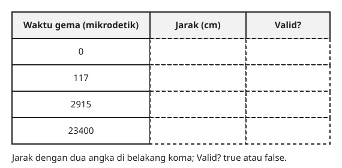

**Ingat dulu:** Tanpa melihat catatan, jawab. (1) Mengapa pengurutan untuk median dilakukan pada salinan larik, bukan pada larik aslinya? ______ (2) Mengapa fungsi `cetak` menerima `const Pembacaan&`, bukan salinan `Pembacaan`? ______



`[Gambar: tabel tiga kolom: Waktu gema (mikrodetik), Jarak (cm), dan Valid?. Kolom pertama berisi 0, 117, 2915, dan 23400. Dua kolom lain kosong; kamu isi jarak dengan dua angka di belakang koma dan true atau false.]`

**Prediksi:** Bagian murni pustaka mengubah waktu gema (mikrodetik) menjadi sentimeter dengan `waktu x 0,0343 / 2`, dan menganggap jarak **valid** bila antara 2,0 dan 400,0 cm. Tebak dulu, tulis jawabanmu, baru isi tabel pada gambar.

1. Berapa jarak untuk tiap waktu gema (dua angka di belakang koma)? ______
2. Mana yang valid? ______
3. Mengapa waktu 0 tidak boleh dianggap "jarak 0 cm yang valid", dan mengapa 116 dan 117 mikrodetik hanya selisih satu tetapi hasilnya berbeda? ______

**Lengkapi:** Kelas kecil yang menyimpan satu pin LED dan menyalakannya. Isi bagian `____`.

```arduino setengah-jadi
class Lampu {
 public:
  Lampu(int pin) : pin_(pin) {}
  void mulai() { pinMode(____, OUTPUT); }
  void nyalakan() { digitalWrite(pin_, ____); }
 ____:
  int pin_;
};
```

**Susun:** Urutkan baris menjadi `bacaCm`.

```text
(a)   float hasil = cmDariMikrodetik(mikrodetik);
(b)   return true;
(c)   if (!dalamRentang(hasil)) {
(d)   cm = hasil;
(e)     return false;
(f)   }
(g)   unsigned long mikrodetik = 0;
(h)   if (!bacaMikrodetik(mikrodetik)) {
(i)     return false;
(j)   }
(k) bool bacaCm(float &cm) {
(l) }
```

Urutan: ______ ______ ______ ______ ______ ______ ______ ______ ______ ______ ______ ______

**Latihan:**

1. `AI: tanpa AI` Apa yang terjadi pada program bila `while (digitalRead(gema_) == LOW)` tidak punya batas waktu dan kabel gema terlepas? ______
2. `AI: tanpa AI` Mengapa tidak ada waktu gema bulat yang menghasilkan tepat 2,00 cm, dan bagaimana pasangan 116 dan 117 mikrodetik tetap menguji batas bawah? ______
3. `AI: boleh` Tulis pseudocode fungsi `bacaRataCm(float &cm, int jumlah)` yang memanggil `bacaCm` sebanyak `jumlah` kali, menghitung rata-rata pembacaan yang valid, dan mengembalikan `false` bila tidak ada satu pun yang valid. ______

**Cek diri:**

- [ ] Saya dapat menulis kelas dengan anggota privat dan publik.
- [ ] Saya memisahkan bagian perangkat keras dari bagian murni.
- [ ] Saya memberi batas waktu tunggu pada pembacaan perangkat.

**Catatan cetak (untuk guru, tidak dicetak):** dua halaman A4. Kunci ada di modul `c-xi1-m4`, bagian "Kunci dan petunjuk". Lembar tidak memuat kolom identitas.
