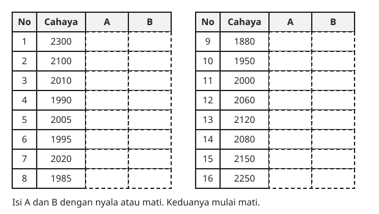

**Ingat dulu:** Tanpa melihat catatan, jawab. (1) Bila jarak berayun antara 19 dan 21 cm di sekitar batas 20 cm, apa yang terjadi pada alarm, dan mengapa itu mengganggu? ______ (2) Mengapa fungsi yang tidak menyentuh pin lebih mudah diuji di komputer? ______



`[Gambar: dua tabel berdampingan, masing-masing delapan baris, dengan kolom No, Cahaya, A, dan B. Nomor 1 sampai 16 dengan cahaya 2300, 2100, 2010, 1990, 2005, 1995, 2020, 1985, 1880, 1950, 2000, 2060, 2120, 2080, 2150, 2250. Kolom A dan B kosong; kamu isi nyala atau mati.]`

**Prediksi:** Lampu menyala bila cahaya gelap. Solusi A (ambang): nyala bila `cahaya < 2000`. Solusi B (histeresis): nyala bila `cahaya < 1900`, mati bila `cahaya > 2100`, dan di antaranya **tetap seperti sebelumnya**. Keduanya mulai dalam keadaan mati. Data cahaya mentah berurutan ada pada tabel di gambar. Tebak dulu, tulis jawabanmu, baru isi tabel.

1. Berapa kali lampu berganti keadaan pada solusi A, dan pada solusi B? ______
2. Pada masukan 1985, apa keadaan lampu menurut A dan menurut B? ______
3. Pada masukan 2000, mengapa A dan B berbeda? ______

**Lengkapi:** Kipas menyala bila suhu di atas 30,0 dan mati bila di bawah 28,0, dan di antaranya tetap. Isi bagian `____`.

```cpp setengah-jadi
bool kipasHisteresis(bool sebelumnya, float suhu) {
  if (suhu ____ 30.0f) {
    return true;
  }
  if (suhu ____ 28.0f) {
    return false;
  }
  return ____;
}
```

**Susun:** Urutkan baris menjadi `lampuHisteresis`.

```text
(a)   return sebelumnya;
(b)   if (cahaya > BATAS_MATI) {
(c) bool lampuHisteresis(bool sebelumnya, int cahaya) {
(d)     return false;
(e)   }
(f)   if (cahaya < BATAS_NYALA) {
(g)     return true;
(h)   }
(i) }
```

Urutan: ______ ______ ______ ______ ______ ______ ______ ______ ______

**Latihan:**

1. `AI: tanpa AI` Pada solusi B dengan data di gambar, di nomor mana lampu menyala pertama kali dan di nomor mana mati? ______
2. `AI: tanpa AI` Apa yang terjadi bila `BATAS_NYALA` diisi 2100 dan `BATAS_MATI` diisi 1900? ______
3. `AI: boleh` Pada cahaya tetap, pembacaan berayun antara 1960 dan 2040. Usulkan `BATAS_NYALA` dan `BATAS_MATI` untuk batas keputusan 2000 dan jelaskan alasannya. ______

**Cek diri:**

- [ ] Saya dapat menjelaskan mengapa satu ambang membuat keluaran berkedip.
- [ ] Saya dapat menulis fungsi histeresis dengan dua batas dan keadaan sebelumnya.
- [ ] Saya menyebut apa yang dikorbankan oleh histeresis.

**Catatan cetak (untuk guru, tidak dicetak):** dua halaman A4. Kunci ada di modul `c-xi1-m5`, bagian "Kunci dan petunjuk". Lembar tidak memuat kolom identitas.
