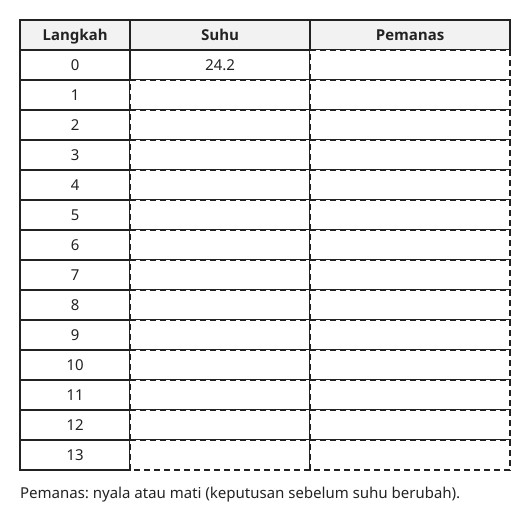

**Ingat dulu:** Tanpa melihat catatan, jawab. (1) Mengapa histeresis memakai dua batas yang berbeda, bukan satu? ______ (2) Apa yang terjadi bila `Penyangga` dipakai tanpa memberi nilai awal pada `terisi`? ______



`[Gambar: tabel tiga kolom: Langkah, Suhu, dan Pemanas. Langkah 0 sampai 13. Suhu pada langkah 0 terisi 24,2; sel suhu lain dan semua sel Pemanas kosong. Kamu isi suhu dan keputusan nyala atau mati langkah demi langkah.]`

**Prediksi:** Ruangan karangan: setiap langkah, bila pemanas menyala suhu naik 0,7; bila mati suhu turun 0,5. Nilai acuan 28,0 dan lebar pita 1,0, jadi pemanas menyala bila suhu di bawah 27,0 dan mati bila di atas 29,0, dan di antaranya tetap. Suhu awal 24,2 dan pemanas mati. Keputusan diambil sebelum suhu berubah pada langkah itu. Tebak dulu, tulis jawabanmu, baru isi tabel.

1. Pada langkah ke berapa dan pada suhu berapa pemanas **pertama kali mati**? ______
2. Setelah mati, pada langkah ke berapa pemanas **menyala lagi**, dan pada suhu berapa? ______
3. Apakah suhu pernah berhenti tepat di 28,0? Mengapa? ______

**Lengkapi:** Kipas pendingin yang menyala bila **panas**: nilai acuan 30,0 dan lebar pita 1,0 (menyala di atas 31,0, mati di bawah 29,0). Isi bagian `____`.

```cpp setengah-jadi
const float SETPOINT = 30.0f;
const float PITA = 1.0f;

bool keputusanKipas(bool sebelumnya, float suhu) {
  if (suhu ____ SETPOINT + PITA) {
    return true;
  }
  if (suhu ____ SETPOINT - PITA) {
    return false;
  }
  return ____;
}
```

**Susun:** Urutkan baris menjadi `loop()` yang memperbarui pemanas tiap `SELANG_MS`.

```text
(a)     digitalWrite(PIN_PEMANAS, pemanas ? HIGH : LOW);
(b) void loop() {
(c)     pemanas = keputusanPemanas(pemanas, suhu);
(d)   }
(e)     float suhu = suhuDariMentah(analogRead(PIN_SUHU));
(f)   if (millis() - mulai >= SELANG_MS) {
(g)     mulai += SELANG_MS;
(h) }
```

Urutan: ______ ______ ______ ______ ______ ______ ______ ______

**Latihan:**

1. `AI: tanpa AI` Pada `keputusanPemanas` versi Arduino, apa yang terjadi bila kabel sensor terlepas dan `analogRead` mengembalikan 0? Mengapa itu diperlakukan sebagai keadaan aman? ______
2. `AI: tanpa AI` Bila `PITA` diperkecil menjadi 0,2 pada model contoh, apa yang terjadi pada jumlah pergantian dan pada lebar ayunan? Jelaskan dengan akal sehat. ______
3. `AI: boleh` Tulis pseudocode simulasi untuk kipas pada Lengkapi: suhu awal 33,0; bila kipas menyala suhu turun 0,6 per langkah; bila mati suhu naik 0,4 per langkah; 40 langkah. Cetak setiap pergantian. ______

**Cek diri:**

- [ ] Saya dapat menjelaskan kendali hidup-mati dengan nilai acuan dan pita.
- [ ] Saya menetapkan keadaan aman bila sensor tidak valid.
- [ ] Saya tidak menyambung beban listrik nyata pada papan.

**Catatan cetak (untuk guru, tidak dicetak):** dua halaman A4. Kunci ada di modul `c-xi1-m6`, bagian "Kunci dan petunjuk". Lembar tidak memuat kolom identitas.
