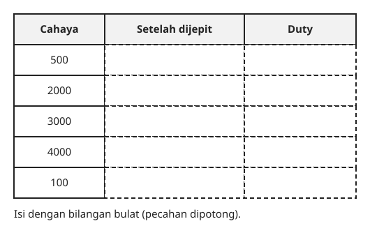

**Ingat dulu:** Tanpa melihat catatan, jawab. (1) Mengapa penyaring dipasang sebelum keputusan, bukan sesudahnya? ______ (2) Pada termostat hidup-mati, mengapa suhu tidak pernah tepat di nilai acuan melainkan berayun? ______



`[Gambar: tabel tiga kolom: Cahaya, Cahaya setelah dijepit, dan Duty. Kolom Cahaya berisi 500, 2000, 3000, 4000, dan 100. Dua kolom lain kosong; kamu isi dengan bilangan bulat.]`

**Prediksi:** Fungsi `dutyProporsional(cahaya)` mengatur kecerahan LED: makin gelap, makin terang. `cahaya` dijepit ke rentang `GELAP = 500` sampai `TERANG = 3500`, lalu duty-nya `(TERANG - cahaya) * 255 / (TERANG - GELAP)` dengan bilangan bulat (pecahan dipotong). Tebak dulu, tulis jawabanmu, baru isi tabel.

1. Berapa duty untuk cahaya 500, 2000, 3000, 4000, dan 100? ______
2. Pada data berderau di sekitar 2000, mana yang kamu duga keluarannya melonjak paling besar antar pembacaan: hidup-mati (menyala penuh bila cahaya di bawah 2000) atau proporsional? ______
3. Pada cahaya 3000, LED hidup-mati mati total. Apa yang dilakukan LED proporsional, dan apakah itu keuntungan atau kerugian? ______

**Lengkapi:** Fungsi duty dengan penjepitan di kedua ujung. Isi bagian `____`.

```cpp setengah-jadi
const int GELAP = 500;
const int TERANG = 3500;

int duty(int cahaya) {
  int c = cahaya;
  if (c < GELAP) {
    c = ____;
  }
  if (c > TERANG) {
    c = ____;
  }
  return (TERANG - c) * 255 / (____ - GELAP);
}
```

**Susun:** Urutkan baris menjadi `dutyProporsional`.

```text
(a)   return (TERANG - c) * DUTY_MAKS / (TERANG - GELAP);
(b)   if (c > TERANG) {
(c) int dutyProporsional(int cahaya) {
(d)     c = GELAP;
(e)   }
(f)   int c = cahaya;
(g)   if (c < GELAP) {
(h)     c = TERANG;
(i)   }
(j) }
```

Urutan: ______ ______ ______ ______ ______ ______ ______ ______ ______ ______

**Latihan:**

1. `AI: tanpa AI` Berapa `dutyProporsional(1000)` dan `dutyProporsional(2500)` dengan bilangan bulat? Tunjukkan langkahnya. ______
2. `AI: tanpa AI` Apa yang terjadi bila `GELAP` dan `TERANG` diisi sama dengan 1000? Bagaimana mencegahnya? ______
3. `AI: boleh` Tulis pseudocode fungsi `dutyKipas(float suhu)` yang proporsional: 0 pada suhu 26,0 ke bawah, 255 pada suhu 34,0 ke atas, dan linear di antaranya. Uji pada 20, 26, 30, 34, dan 40. ______

**Cek diri:**

- [ ] Saya dapat menjelaskan kendali proporsional dan menulis rumusnya dengan bilangan bulat.
- [ ] Saya menjepit masukan pada kedua ujung dan menghindari pembagian dengan nol.
- [ ] Saya mengukur `GELAP` dan `TERANG` dari rangkaianku, tidak menebak.

**Catatan cetak (untuk guru, tidak dicetak):** dua halaman A4. Kunci ada di modul `c-xi1-m7`, bagian "Kunci dan petunjuk". Lembar tidak memuat kolom identitas.
