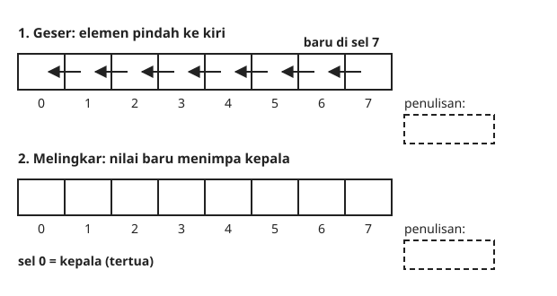

**Ingat dulu:** Tanpa melihat catatan, jawab. (1) Mengapa rumus duty ditulis mengalikan dulu baru membagi pada bilangan bulat? ______ (2) Apa yang harus dilakukan antrian penuh ketika data baru datang, dan apa harga tiap pilihannya? ______



`[Gambar: dua baris larik berisi delapan sel berindeks 0 sampai 7. Baris pertama berlabel geser: panah dari tiap sel ke sel di kirinya, dan nilai baru masuk di sel 7. Baris kedua berlabel melingkar: sel 0 ditandai kepala (tertua) dan nilai baru menimpanya. Di samping tiap baris ada kotak kosong untuk jumlah penulisan elemen.]`

**Prediksi:** Dua cara menyimpan 8 pembacaan terakhir: **geser** (pembacaan baru masuk di ujung, semua yang lain digeser satu tempat) dan **melingkar** (pembacaan baru menimpa yang tertua, tanpa menggeser). Keduanya sudah penuh dan menerima satu pembacaan lagi. Tebak dulu, tulis jawabanmu, baru telusuri.

1. Berapa kali sebuah elemen larik disalin atau ditulis pada satu sisipan dengan cara geser? Dengan cara melingkar? Tulis di kotak pada gambar. ______
2. Bila jendelanya diperbesar menjadi 512, bagaimana angka itu berubah untuk masing-masing cara? ______
3. Apakah kedua cara menghasilkan jumlah isi jendela yang sama? ______

**Lengkapi:** Hitung berapa pembacaan yang muat dalam anggaran. Ukuran satu pembacaan diambil dari `sizeof`, bukan ditebak. Isi bagian `____`.

```cpp setengah-jadi
#include <cstdint>

struct Pembacaan {
  int16_t suhu10;
  int16_t cahaya;
};

int jumlahMuat(int anggaranByte) {
  return anggaranByte / ____(____);
}
```

**Susun:** Urutkan baris menjadi `tambahGeser` yang menghitung salinan.

```text
(a)   j.data[j.terisi] = nilai;
(b) void tambahGeser(Jendela& j, int nilai) {
(c)     }
(d)     for (int i = 1; i < j.kapasitas; i++) {
(e)   if (j.terisi == j.kapasitas) {
(f)       salinan++;
(g)       j.data[i - 1] = j.data[i];
(h)     j.terisi = j.kapasitas - 1;
(i)   }
(j)   salinan++;
(k)   j.terisi++;
(l) }
```

Urutan: ______ ______ ______ ______ ______ ______ ______ ______ ______ ______ ______ ______

**Latihan:**

1. `AI: tanpa AI` Jendela berkapasitas 100 menerima 300 sampel. Berapa penulisan elemen total dengan cara geser, dan dengan cara melingkar? Tunjukkan langkahnya. ______
2. `AI: tanpa AI` Sensor menghasilkan 50 pembacaan per detik dan kamu memerlukan jendela 5 detik dari `int16_t`. Berapa byte jendelanya? Berapa penulisan per detik pada cara geser dan pada cara melingkar? Mana yang kamu pilih bila papanmu juga harus mengerjakan hal lain, dan apa harganya? ______
3. `AI: boleh` Satu pembacaan disimpan sebagai `struct` dengan `uint32_t detik`, `int16_t suhu10`, `int16_t cahaya`, dan `bool valid`. Tulis pseudocode program kecil yang mencetak `sizeof` struct itu dan berapa pembacaan yang muat dalam 2000 byte. ______

**Cek diri:**

- [ ] Saya menghitung operasi untuk membandingkan solusi, bukan menebak.
- [ ] Saya dapat menyebut harga cara geser dan cara melingkar.
- [ ] Saya tahu bahwa ukuran di komputer belum tentu sama di papanku.

**Catatan cetak (untuk guru, tidak dicetak):** dua halaman A4. Kunci ada di modul `c-xi1-m8`, bagian "Kunci dan petunjuk". Lembar tidak memuat kolom identitas.
