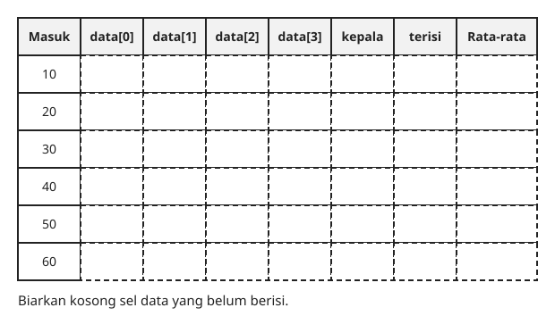

**Ingat dulu:** Tanpa melihat catatan, jawab. (1) Bila sensor suhu gagal dibaca, apakah pemanas sebaiknya tetap menyala atau dimatikan, dan mengapa? ______ (2) Pada jendela 64, berapa penulisan elemen per sisipan untuk cara geser dan untuk cara melingkar? ______



`[Gambar: tabel sembilan kolom: Masuk, data[0], data[1], data[2], data[3], kepala, terisi, dan Rata-rata. Kolom Masuk berisi 10, 20, 30, 40, 50, dan 60. Semua kolom lain kosong; kamu isi isi larik, kepala, terisi, dan rata-rata setelah tiap nilai masuk.]`

**Prediksi:** Penyangga berkapasitas 4 yang awalnya kosong menerima 10, 20, 30, 40, 50, 60 berurutan. Bila penuh, nilai baru **menimpa yang tertua**. Tebak dulu, tulis jawabanmu, baru telusuri dengan tabel pada gambar.

1. Setelah 60 masuk, nilai apa saja yang tersimpan, dari yang tertua ke yang terbaru? ______
2. Berapa rata-rata setelah 40 masuk, dan berapa setelah 60 masuk? ______
3. Setelah 60 masuk, di indeks larik berapa letak nilai tertua (itu `kepala`)? ______

**Lengkapi:** `tambah` untuk penyangga berkapasitas 3 yang menimpa yang tertua saat penuh. Bagian `____` ada pada dua tempat.

```cpp setengah-jadi
const int KAPASITAS = 3;

struct Penyangga {
  int data[KAPASITAS];
  int kepala;
  int terisi;
};

void tambah(Penyangga& b, int nilai) {
  if (b.terisi == KAPASITAS) {
    b.data[b.kepala] = nilai;
    b.kepala = (b.kepala + 1) % ____;
  } else {
    b.data[(b.kepala + ____) % KAPASITAS] = nilai;
    b.terisi++;
  }
}
```

**Susun:** Urutkan baris menjadi `terbaru`, yang mengembalikan nilai terbaru dan `false` bila kosong.

```text
(a)   nilai = b.data[(b.kepala + b.terisi - 1) % KAPASITAS];
(b) bool terbaru(const Penyangga& b, int& nilai) {
(c)   return true;
(d)   if (b.terisi == 0) {
(e)     return false;
(f)   }
(g) }
```

Urutan: ______ ______ ______ ______ ______ ______ ______

**Latihan:**

1. `AI: tanpa AI` Kapasitas 3, urutan masuk 7, 1, 9, 4, 8. Tulis isi larik di memori, `kepala`, `terisi`, urutan logis dari tertua, dan rata-rata setelah 8 masuk. ______
2. `AI: tanpa AI` Penyangga berkapasitas 4 dan nilai 10 sampai 60 seperti pada Prediksi. Seorang murid lupa baris `b.jumlah -= b.data[b.kepala];` (pengurangan nilai yang tertimpa dari jumlah isi). Rata-rata apa yang ia laporkan setelah enam nilai, dan apa yang benar? ______
3. `AI: boleh` Tulis pseudocode fungsi `terbaru` (seperti pada Susun) dan fungsi `tertua` untuk `Penyangga` kapasitas 3. Uji pada urutan 7, 1, 9, 4, 8. ______

**Cek diri:**

- [ ] Saya dapat menjelaskan peran `kepala`, `terisi`, dan `%` pada penyangga melingkar.
- [ ] Saya menguji keadaan kosong, tepat penuh, dan berputar.
- [ ] Saya dapat menyebut harga penyangga melingkar dibanding larik yang digeser.

**Catatan cetak (untuk guru, tidak dicetak):** dua halaman A4. Kunci ada di modul `c-xi1-m9`, bagian "Kunci dan petunjuk". Lembar tidak memuat kolom identitas.
