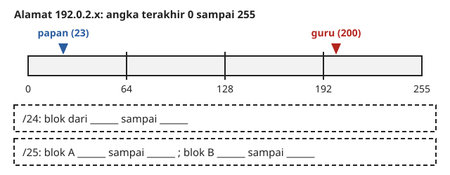

**Ingat dulu:** Tanpa melihat catatan, jawab. (1) Mengapa memeriksa daya dan kabel sebelum membaca kode? ______ (2) Sebutkan lima tahap diagnosis gangguan jaringan dari lapisan fisik sampai layanan. ______



`[Gambar: garis bilangan 0 sampai 255 untuk bagian terakhir alamat 192.0.2.x, dengan tanda di 64, 128, dan 192. Papan ditandai di 23 dan komputer guru di 200. Di bawahnya ada dua baris isian kosong: satu untuk awalan /24 dan satu untuk awalan /25, tempat kamu menulis awal dan akhir tiap blok jaringan.]`

**Prediksi:** Tebak dulu, tulis jawabanmu, baru telusuri. Papan berada di `192.0.2.23` dan jaringan lab memakai awalan `/24`. (1) Apakah komputer guru di `192.0.2.200` sejaringan dengan papan? ______ Bagaimana dengan `198.51.100.5`? ______ (2) Bila awalannya diubah menjadi `/25`, apakah `192.0.2.200` masih sejaringan? ______ Tulis blok jaringan pada gambar. (3) Mengapa papan tidak perlu diberi alamat IP secara manual di kode? ______

**Lengkapi:** `jumlahAlamat` memberi banyaknya alamat dalam satu jaringan dengan awalan tertentu, dan `adalahAlamatJaringan` menguji apakah seluruh bit bagian perangkat bernilai 0. Isi bagian `____`.

```cpp setengah-jadi
// C++17. Lengkapi bagian ____.
#include <cstdint>

uint32_t jumlahAlamat(int prefiks) {
  return ____ << (32 - prefiks);
}

bool adalahAlamatJaringan(uint32_t alamat, int prefiks) {
  uint32_t topengBit = 0xFFFFFFFFu << (32 - prefiks);
  return (alamat & ~topengBit) == ____;
}
```

**Susun:** Susun baris A sampai I menjadi `setup()` yang menghubungkan papan, menunggu dengan batas waktu, lalu mencetak alamatnya.

```text
(A)   WiFi.begin(NAMA_JARINGAN, SANDI_JARINGAN);
(B) void setup() {
(C)   Serial.begin(115200);
(D)   unsigned long mulai = millis();
(E)   while (WiFi.status() != WL_CONNECTED && millis() - mulai < BATAS_MS) {
(F)     delay(250);
(G)   }
(H)   Serial.println(WiFi.localIP().toString());
(I) }
```

Urutan: ______ ______ ______ ______ ______ ______ ______ ______ ______

**Latihan:**

1. `AI: tanpa AI` Papan di `192.0.2.77` dengan awalan `/26` (blok berukuran 64). Apakah `192.0.2.100` sejaringan? ______ Bagaimana dengan `192.0.2.130`? ______ Tunjukkan blok jaringan masing-masing. ______
2. `AI: boleh` Tulis pseudocode lalu ubah sketsa agar mencetak berapa milidetik yang dipakai sampai tersambung. ______
3. `AI: tanpa AI` Setelah 15 detik papan belum tersambung. Sebut tiga penyebab yang kamu periksa, urut dari tahap fisik. ______
4. `AI: tanpa AI` Ubah setiap bagian alamat `192.0.2.10` ke biner delapan bit. ______

**Cek diri:**

- [ ] Saya dapat menjelaskan peran nama jaringan, sandi, dan alamat IP bagi papan.
- [ ] Saya dapat menentukan apakah dua alamat sejaringan dari awalan.
- [ ] Saya memberi batas waktu pada penantian sambungan dan mencetak hasilnya.

**Catatan cetak (untuk guru, tidak dicetak):** dua halaman A4. Kunci ada di modul `c-xi2-m1`, bagian "Kunci dan petunjuk". Lembar tidak memuat kolom identitas.
