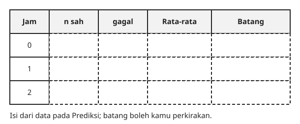

**Ingat dulu:** Tanpa melihat catatan, jawab. (1) Mengapa teks di dalam JSON harus meloloskan tanda kutip? ______ (2) Mengapa satuan dan lokasi pengukuran dicatat di catatan sumber? ______



`[Gambar: tabel lima kolom: Jam, n sah, gagal, Rata-rata, dan Batang. Tiga baris untuk jam 0, 1, dan 2. Semua sel selain kolom Jam kosong; kamu isi dari data pada Prediksi.]`

**Prediksi:** Dua belas pembacaan suhu karangan, satu nilai tiap kira-kira 20 menit. Pembacaan dikelompokkan per jam (detik dibagi 3600, dibulatkan ke bawah); pembacaan yang gagal dilewati tetapi dihitung. Tebak dulu, tulis jawabanmu, baru isi tabel pada gambar.

| Detik | 300 | 1500 | 2700 | 3300 | 3900 | 5100 | 6300 | 6900 | 7500 | 8700 | 9900 | 10500 |
| --- | --- | --- | --- | --- | --- | --- | --- | --- | --- | --- | --- | --- |
| Suhu | 27,0 | 27,4 | 27,9 | 28,5 | 28,8 | gagal | 29,6 | 29,2 | 29,0 | 28,4 | 27,8 | 27,5 |

1. Berapa pembacaan sah dan berapa yang gagal pada jam ke-1? ______
2. Jam mana yang rata-ratanya tertinggi? Perkirakan rata-ratanya. ______
3. Batang jam ke-0 lebih panjang atau lebih pendek daripada batang jam ke-2? Mengapa? ______

**Lengkapi:** `tambah` harus menghitung pembacaan hilang, memperbarui nilai terkecil dan terbesar, dan menjumlahkan hanya pembacaan sah. Isi bagian `____`.

```cpp setengah-jadi
#include <cmath>

struct Rekap {
  int n = 0;
  int hilang = 0;
  double jumlah = 0;
  double min = 0;
  double max = 0;
};

void tambah(Rekap &r, double suhu) {
  if (std::isnan(suhu)) {
    r.hilang____;
    return;
  }
  if (r.n == 0 || suhu < r.min) r.min = ____;
  if (r.n == 0 || suhu ____ r.max) r.max = suhu;
  r.jumlah += suhu;
  r.n____;
}
```

**Susun:** Urutkan baris menjadi `panjangBatang`: tinggi batang sebanding dengan jarak dari batas bawah sumbu, dan tidak pernah negatif.

```text
(a)   if (p < 0) p = 0;
(b) int panjangBatang(double rata) {
(c)   return p;
(d) }
(e)   int p = static_cast<int>(std::lround((rata - BATAS_BAWAH) * SKALA));
```

Urutan: ______ ______ ______ ______ ______

**Latihan:**

1. `AI: tanpa AI` Pembacaan (detik; suhu): (600; 26,0), (1800; 27,0), (2400; gagal), (3700; 28,0), (5000; 29,5). Buat tabel per jam; panjang batang memakai satu tanda per 0,25 derajat di atas 26.

| Jam | n sah | gagal | terkecil | rata-rata | terbesar | batang |
| --- | --- | --- | --- | --- | --- | --- |
| 0 | | | | | | |
| 1 | | | | | | |

2. `AI: tanpa AI` Dua grafik batang menampilkan rata-rata 27,7 (jam 0) dan 29,2 (jam 1): grafik A dengan sumbu dari 0, grafik B dengan sumbu dari 26. Tulis kesan yang timbul pada tiap grafik, dan keterangan apa yang wajib ditambahkan pada grafik B. ______
3. `AI: boleh` Tulis pseudocode satu kolom **rentang** (terbesar dikurangi terkecil) per jam. Sebutkan tiga kasus uji, termasuk jam yang semua pembacaannya gagal. ______

**Cek diri:**

- [ ] Saya mencatat jumlah pembacaan yang gagal tiap kelompok.
- [ ] Saya menjaga agar kelompok kosong tidak dibagi dengan nol.
- [ ] Saya dapat menjelaskan bagaimana titik mulai sumbu mengubah kesan.

**Catatan cetak (untuk guru, tidak dicetak):** dua halaman A4. Kunci ada di modul `c-xi2-m10`, bagian "Kunci dan petunjuk". Lembar tidak memuat kolom identitas.
