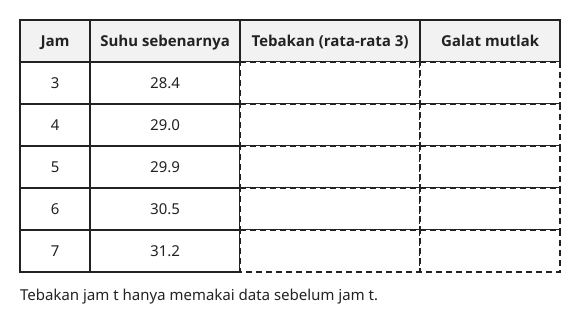

**Ingat dulu:** Tanpa melihat catatan, jawab. (1) Sebut lima lapis diagnosis jaringan IoT berurutan, dan satu pengamatan murah untuk tiap lapis. ______ (2) Mengapa sumbu grafik yang tidak dimulai dari nol harus dinyatakan dengan jelas? ______



`[Gambar: tabel empat kolom: Jam, Suhu sebenarnya, Tebakan (rata-rata 3 nilai terakhir), dan Galat mutlak. Lima baris untuk jam 3 sampai 7 dengan suhu 28,4; 29,0; 29,9; 30,5; dan 31,2. Dua kolom lain kosong; kamu isi tebakan dan galatnya.]`

**Prediksi:** Suhu per jam (karangan), jam 0 sampai 7: 26,0; 26,8; 27,5; 28,4; 29,0; 29,9; 30,5; 31,2. Pada tiap jam `t`, tebakan hanya memakai data sebelum jam `t`: rata-rata bergerak tiga nilai terakhir, dan garis lurus yang dicocokkan ke semua nilai sebelumnya. Tebak dulu, tulis jawabanmu, baru isi tabel.

1. Untuk jam 7, hitung tebakan rata-rata bergerak tiga nilai terakhir (jam 4, 5, 6) dan galatnya terhadap 31,2. ______
2. Metode mana yang galat mutlak rata-ratanya lebih kecil pada data yang terus naik ini: rata-rata bergerak atau garis tren? Mengapa? ______
3. Bila suhu naik lalu turun (28, 29, 30, 29, 28), apa yang terjadi pada tebakan garis tren untuk nilai berikutnya? ______

**Lengkapi:** `cocokkan` memakai rumus kuadrat terkecil. Isi bagian `____`.

```cpp setengah-jadi
struct Garis {
  double kemiringan;
  double potongan;
};

Garis cocokkan(const double y[], int n) {
  double sx = 0, sy = 0, sxy = 0, sxx = 0;
  for (int i = 0; i < n; i++) {
    sx += i;
    sy += y[i];
    sxy += i * y[i];
    sxx += static_cast<double>(i) * i;
  }
  double penyebut = n * sxx - ____ * sx;
  double m = (n * sxy - sx * ____) / penyebut;
  return {m, (sy - m * ____) / n};
}
```

**Susun:** Urutkan baris menjadi `rataBergerak`: kembalikan `NAN` bila data kurang dari `k`, selain itu rata-rata `k` nilai terakhir.

```text
(a)   double jumlah = 0;
(b)   if (n < k || k <= 0) return NAN;
(c)   for (int i = n - k; i < n; i++) jumlah += y[i];
(d) double rataBergerak(const double y[], int n, int k) {
(e)   return jumlah / k;
(f) }
```

Urutan: ______ ______ ______ ______ ______ ______

**Latihan:**

1. `AI: tanpa AI` Data 20, 22, 21, 25. Hitung tebakan rata-rata bergerak `k = 3` untuk nilai berikutnya. Bila nilai sebenarnya 26, berapa galat mutlaknya? ______
2. `AI: tanpa AI` Data 28, 29, 30, 29, 28. Garis tren yang dicocokkan ke kelima nilai itu mendatar (kemiringan 0). Berapa tebakannya untuk nilai berikutnya dan berapa galatnya bila nilai sebenarnya 27? Berapa tebakan rata-rata bergerak `k = 3` dan galatnya? Apa yang kamu simpulkan? ______
3. `AI: boleh` Tulis pseudocode tebakan untuk jam 8 dari seluruh delapan data dengan kedua metode. Sebutkan tiga kasus uji, termasuk data yang kurang dari `k`. ______

**Cek diri:**

- [ ] Saya dapat menghitung rata-rata bergerak dan memakainya sebagai tebakan.
- [ ] Saya menghitung galat hanya dengan data sebelum titik yang diprediksi.
- [ ] Saya dapat menyebut keadaan yang membuat masing-masing metode gagal.

**Catatan cetak (untuk guru, tidak dicetak):** dua halaman A4. Kunci ada di modul `c-xi2-m11`, bagian "Kunci dan petunjuk". Lembar tidak memuat kolom identitas.
