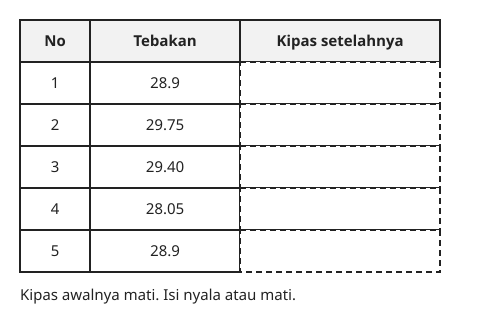

**Ingat dulu:** Tanpa melihat catatan, jawab. (1) Mengapa rata-rata bergerak menebak terlalu rendah pada data yang terus naik? ______ (2) Mengapa pasangan data yang salah satunya hilang dilewati, bukan dihitung sebagai 0? ______



`[Gambar: tabel tiga kolom: No, Tebakan, dan Kipas setelahnya. Lima baris dengan tebakan 28,9; 29,75; 29,40; 28,05; dan 28,9. Kolom Kipas kosong dan kamu isi nyala atau mati. Di bawah tabel tertulis bahwa kipas awalnya mati.]`

**Prediksi:** Fungsi `putuskan(kipas, prediksi)` menyalakan kipas bila tebakan suhu berikutnya **lebih dari 29,5**, mematikannya bila **kurang dari 28,5**, dan di antaranya membiarkan keadaan terakhir. Kipas awalnya mati. Tebak dulu, tulis jawabanmu, baru isi tabel.

1. Tulis keadaan kipas (nyala atau mati) setelah tiap tebakan. ______
2. Pada menit tertentu suhu aktual 29,1, di bawah 29,5, tetapi kipas sudah menyala. Apa penjelasannya? ______
3. Sensor gagal dibaca tiga kali berturut-turut. Menurutmu kipas pendingin sebaiknya menyala atau mati, dan mengapa? ______

**Lengkapi:** `putuskan` memakai kedua batas dan menjaga keadaan di antaranya. Isi bagian `____`.

```cpp setengah-jadi
const double NYALA_DI_ATAS = 29.5;
const double MATI_DI_BAWAH = 28.5;

bool putuskan(bool kipas, double prediksi) {
  if (prediksi ____ NYALA_DI_ATAS) return true;
  if (prediksi ____ MATI_DI_BAWAH) return ____;
  return kipas;
}
```

**Susun:** Urutkan baris menjadi awal fungsi `terima`: pembacaan gagal dihitung, keadaan aman dipicu bila gagal berturut-turut mencapai batas, dan pembacaan sah mengatur ulang hitungan.

```text
(a)   gagal = 0;
(b)   if (std::isnan(suhu)) {
(c)     return;
(d) void terima(double suhu) {
(e)     gagal++;
(f)     if (gagal >= GAGAL_MAKS) kipas = true;
(g)   }
```

Urutan: ______ ______ ______ ______ ______ ______ ______

**Latihan:**

1. `AI: tanpa AI` Kipas awalnya nyala. Tebakan datang berurutan 29,0; 28,4; 29,0; 29,6. Tulis keadaan kipas setelah tiap tebakan (batas 29,5 dan 28,5). ______
2. `AI: tanpa AI` Tentukan keadaan aman bila sensor gagal untuk (a) kipas pendingin kecil, (b) pemanas LED simulasi seperti di `c-xi1-m13`, (c) pompa kecil yang mengisi bak. Tulis alasan tiap pilihan dalam satu kalimat. Mengapa `GAGAL_MAKS` bukan 1 dan bukan 100? ______
3. `AI: boleh` Tulis pseudocode **pembatas keselamatan**: bila suhu aktual lebih dari 32,0, kipas menyala tanpa memandang tebakan. Sebutkan tiga kasus uji, termasuk tepat 32,0 dan 32,1. ______

**Cek diri:**

- [ ] Saya menulis fungsi keputusan yang murni dan mengujinya di komputer.
- [ ] Saya menentukan keadaan aman dan menuliskan alasannya.
- [ ] Saya tahu aturan keselamatan untuk menyambung kipas lewat modul pengendali.

**Catatan cetak (untuk guru, tidak dicetak):** dua halaman A4. Kunci ada di modul `c-xi2-m12`, bagian "Kunci dan petunjuk". Lembar tidak memuat kolom identitas.
