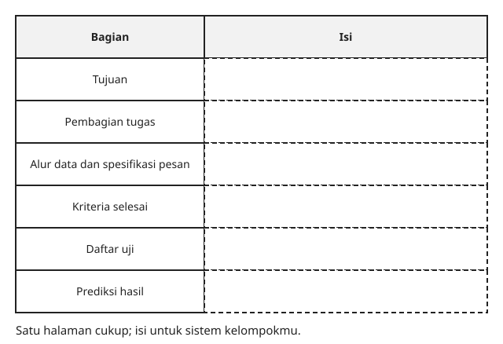

**Ingat dulu:** Tanpa melihat catatan, jawab. (1) Mengapa rekap per jam perlu mencatat jumlah data sah `n` di samping rata-rata? ______ (2) Mengapa keputusan kipas memakai dua batas (histeresis), bukan satu? ______

`[Gambar: tabel dua kolom: Bagian dan Isi. Kolom Bagian berisi enam baris: Tujuan, Pembagian tugas, Alur data dan spesifikasi pesan, Kriteria selesai, Daftar uji, dan Prediksi hasil. Kolom Isi kosong dan kamu isi untuk sistem IoT lokal kelompokmu.]`

**Lengkapi:** Tulis hasil yang diharapkan untuk tiap masukan sebelum menguji (pemantau suhu lab dengan kipas otomatis; keputusan memakai tebakan garis tren, batas nyala 29,5).

| No | Masukan | Hasil yang diharapkan |
| --- | --- | --- |
| 1 | 28,6; 29,0; 29,5 berurutan | |
| 2 | `{'suhu':29.8}` | |
| 3 | suhu 85,0 (rentang sah 10 sampai 45) | |
| 4 | `"suhu":null` | |
| 5 | tidak ada pesan sah selama 10 detik | |

**Latihan:**

1. Laporanmu memakai data terbuka berlisensi atribusi sebagai pembanding. Apa yang harus ada di laporan? ______
2. Tiga suhu terbaru 28,6; 29,0; 29,5. Berapa tebakan garis tren untuk suhu berikutnya, dan apakah kipas menyala dengan batas 29,5? ______
3. Isi lembar rencana pada gambar untuk sistem IoT lokal kelompokmu. ______

**Cek diri:**

- [ ] Saya menulis rencana, spesifikasi pesan, keadaan aman, dan kriteria selesai sebelum merakit.
- [ ] Saya menguji pesan rusak, di luar rentang, sensor gagal, tepat di batas, dan pesan berhenti.
- [ ] Saya menulis laporan satu halaman dan memberi umpan balik dalam tiga kalimat.

**Catatan cetak (untuk guru, tidak dicetak):** dua halaman A4. Kunci ada di modul `c-xi2-m13`, bagian "Kunci dan petunjuk". Bagian Prediksi dan Susun dilewati karena modul proyek ini tidak memuat soal Parsons dan prediksinya sama dengan latihan 2. Lembar tidak memuat kolom identitas.
