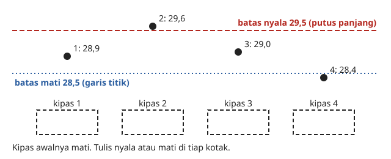

**Ingat dulu:** Tanpa melihat catatan, jawab. (1) Mengapa papan berlangganan ulang setelah tersambung kembali ke broker? ______ (2) Sebut tiga hal yang tidak boleh ditempel ke layanan AI. ______ (3) Mengapa "papan tersambung ke Wi-Fi" belum berarti "data sampai ke penerima"? ______ (4) Beri satu contoh kriteria selesai yang dapat diuji untuk sistem kipas, dan satu yang tidak dapat diuji. ______

`[Gambar: dua garis mendatar, batas nyala 29,5 di atas dan batas mati 28,5 di bawah. Empat kolom bernomor 1 sampai 4 memuat tebakan 28,9; 29,6; 29,0; dan 28,4. Di bawah tiap kolom ada kotak kosong untuk menulis keadaan kipas (nyala atau mati). Kipas awalnya mati.]`

**Prediksi:** Tebak dulu, tulis jawabanmu, baru telusuri. Kipas awalnya mati. Kipas menyala bila tebakan melewati batas nyala dan mati bila tebakan turun melewati batas mati; di antara kedua batas keadaannya tetap. Isi keadaan kipas pada gambar. Lalu: papan `192.0.2.23` dan broker `192.0.2.200` dengan awalan `/25`, sejaringan atau tidak? ______

**Latihan:** `AI: tanpa AI` (asesmen ini tanpa AI).

1. Susun pesan JSON untuk pembacaan sensor `s03`, suhu 31,3, pada detik 210, dan untuk pembacaan `s03` yang gagal dibaca pada detik 215. Berapa karakter panjang pesan yang pertama? ______ Mengapa `nan` tidak boleh dipakai? ______
2. Pembacaan jam 0: 27,0, gagal, 28,0; jam 1: 29,0 dan 30,0. Tulis jumlah sah, jumlah gagal, terkecil, rata-rata, dan terbesar tiap jam. ______
3. Tiga suhu terbaru 27, 28, 29 dan nilai berikutnya sebenarnya 30. Berapa tebakan rata-rata bergerak tiga nilai dan galatnya, dan berapa tebakan garis tren? ______
4. Tulis lapis yang diperiksa pertama dan satu tindakannya untuk tiap kasus: (a) pelanggan menerima `{"suhu":nan}`; (b) dua papan bergantian terputus dari broker dan keduanya berlangganan topik yang sama; (c) kamu menyadari sandi jaringan sempat terunggah ke tempat bersama. ______

**Cek diri:**

- [ ] Saya dapat menjelaskan publikasi-langganan dan mencocokkan topik dengan `+` dan `#`.
- [ ] Saya dapat merekap, memprediksi, dan menghitung galat tanpa memasukkan data hilang.
- [ ] Saya dapat mendiagnosis gangguan jaringan dengan urutan daya, sinyal, alamat, broker, format.

**Catatan cetak (untuk guru, tidak dicetak):** dua halaman A4. Bagian Lengkapi dan Susun dilewati karena modul asesmen tidak memuat contoh setengah jadi atau soal Parsons. Kunci ada di modul `c-xi2-m14`, bagian "Kunci dan petunjuk". Lembar tidak memuat kolom identitas.
