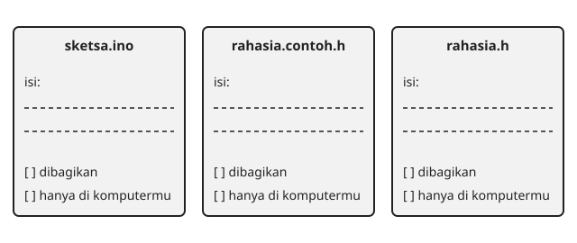

**Ingat dulu:** Tanpa melihat catatan, jawab. (1) Mengapa menulis di luar batas larik bisa menjadi celah keamanan, bukan hanya galat? ______ (2) Sebut dua hal yang tidak boleh ada di berkas proyek yang dibagikan. ______



`[Gambar: tiga kotak berkas. Kotak 1 bernama sketsa.ino, kotak 2 bernama rahasia.contoh.h, kotak 3 bernama rahasia.h. Tiap kotak punya satu garis isian untuk menulis isinya dan dua kotak centang, "dibagikan" dan "hanya di komputermu", yang kamu centang.]`

**Prediksi:** Tebak dulu, tulis jawabanmu, baru telusuri. Pemeriksa menandai baris bila namanya memuat kata kunci seperti `sandi`, `password`, `token`, `apikey`, atau `secret`, ada tanda `=`, dan nilainya teks tidak kosong yang bukan tempat pengisi berawalan `ISI_`.

```text
1: const char* SSID_LAB = "lab-contoh";
2: const char* SANDI_LAB = "kucing-biru-42";
3: const char* TOKEN_SERVER = "ISI_DARI_RAHASIA_H";
4: String apiKey = "contoh-palsu-0000";
5: // sandi lama: kucing-hijau-7
6: int ambang = 2000;
7: const char* PASSWORD_ADMIN = "admin";
```

Baris mana yang ditandai? ______ Adakah rahasia yang lolos? Baris mana? ______ Apakah baris 7 aman karena sandinya "hanya admin"? ______

**Lengkapi:** Sebuah baris komentar (diawali `//`) yang memuat kata `sandi` dan tanda titik dua `:` harus ditandai. Isi bagian `____`.

```cpp setengah-jadi
// C++17. Lengkapi bagian ____.
#include <string>

bool komentarMemuatRahasia(const std::string &baris) {
  bool komentar = baris.rfind("____", 0) == 0;
  bool punyaKataKunci = baris.find("sandi") != std::string::npos;
  bool punyaNilai = baris.find(____) != std::string::npos;
  return komentar && punyaKataKunci && punyaNilai;
}
```

**Susun:** Susun baris A sampai G menjadi fungsi yang menandai baris bila nilai literalnya tidak kosong dan bukan tempat pengisi.

```text
(A)   return isi.rfind("ISI_", 0) == 0 ? "" : "curiga";
(B) }
(C)   std::string isi = isi_literal(baris);
(D)     return "";
(E) std::string curigai(const std::string &baris) {
(F)   if (isi.empty()) {
(G)   }
```

Urutan: ______ ______ ______ ______ ______ ______ ______

**Latihan:**

1. `AI: tanpa AI` Daftarkan semua rahasia yang tertanam pada sketsa di bawah, termasuk yang lolos dari pemeriksa. Untuk tiap rahasia, tulis di mana seharusnya disimpan. ______

   ```text
   const char* NAMA_JARINGAN = "lab-contoh";
   const char* SANDI_JARINGAN = "kucing-biru-42";
   const char* ALAMAT_BROKER = "192.0.2.10";
   const char* SANDI_BROKER = "broker-palsu-1";
   String tokenLaporan = "tok-palsu-12345";
   // uji: sandi admin papan = admin
   ```
2. `AI: tanpa AI` Sebut semua yang tidak boleh dikirim pada permintaan ke asisten AI berikut, lalu tulis ulang permintaan yang aman. ______

   ```text
   Papanku tidak bisa tersambung. Tolong perbaiki kode ini:
   const char* SANDI_JARINGAN = "kucing-biru-42";
   Sandi panel admin router lab adalah admin, alamatnya 192.0.2.1.
   ```
3. `AI: boleh` Tulis lembar periksa keamanan konektivitas berisi lima butir yang dapat dijawab "ya" atau "tidak", mencakup rahasia di luar kode, sandi bawaan, jaringan lab terpisah, dan permintaan ke AI. ______

**Cek diri:**

- [ ] Saya dapat menjelaskan mengapa rahasia tidak boleh tertanam di kode.
- [ ] Saya tahu apa yang dilakukan bila sandi sempat bocor.
- [ ] Saya tidak menempelkan kredensial atau data pribadi ke layanan AI.

**Catatan cetak (untuk guru, tidak dicetak):** dua halaman A4. Kunci ada di modul `c-xi2-m2`, bagian "Kunci dan petunjuk". Lembar tidak memuat kolom identitas.
