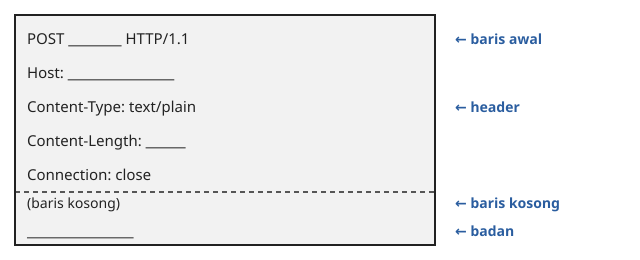

**Ingat dulu:** Tanpa melihat catatan, jawab. (1) Mengapa penyangga melingkar cocok menampung pembacaan bila pengiriman ke server sesekali gagal, dan apa yang hilang bila penuh? ______ (2) Mengapa `sekarang - mulai` tetap benar saat `millis()` kembali ke 0 (tipe `unsigned long`)? ______



`[Gambar: kerangka permintaan HTTP dalam enam baris: baris awal dengan jalur kosong, Host dengan nilai kosong, Content-Type text/plain, Content-Length dengan nilai kosong, Connection close, satu baris kosong, lalu badan kosong. Di kanan tiap baris ada label bagiannya: baris awal, header, baris kosong, badan.]`

**Prediksi:** Tebak dulu, tulis jawabanmu, baru jalankan. Fungsi `kirimDenganUlang` mencoba paling banyak `maks` kali. Ia mengulang hanya bila tidak ada jawaban (kode negatif) atau kode 500 ke atas, dengan jeda awal 500 ms yang dilipatkan tiap kali gagal; sesudah percobaan terakhir ia tidak menunggu lagi. Skenario A (`maks = 4`): kode `-1`, `-1`, `200`. Skenario B (`maks = 4`): kode `400`. Skenario C (`maks = 3`): kode `-1`, `503`, `-1`.

| Skenario | Percobaan | Total jeda (ms) | Terkirim? |
| --- | --- | --- | --- |
| A | | | |
| B | | | |
| C | | | |

Mengapa kode `400` tidak diulang padahal gagal? ______

**Lengkapi:** Ulang bila kode negatif atau 500 ke atas, dan lipatkan jeda dua kali. Isi bagian `____`.

```cpp setengah-jadi
// C++17. Lengkapi bagian ____.
bool layakDiulang(int kode) { return kode ____ 0 || kode >= ____; }

int tungguBerikut(int tunggu) { return tunggu * ____; }
```

**Susun:** Susun baris A sampai J menjadi fungsi `kirimSuhu`: buat klien, mulai, tambah header, kirim, tutup, lalu laporkan.

```text
(A)   http.end();
(B) bool kirimSuhu(float suhu) {
(C)   HTTPClient http;
(D)   if (!http.begin(ALAMAT_SERVER)) {
(E)     return false;
(F)   }
(G)   int kode = http.POST(String("suhu=") + String(suhu, 1));
(H)   return kode >= 200 && kode < 300;
(I) }
(J)   http.addHeader("Content-Type", "text/plain");
```

Urutan: ______ ______ ______ ______ ______ ______ ______ ______ ______ ______

**Latihan:**

1. `AI: tanpa AI` Isi kerangka pada gambar untuk permintaan POST ke host `192.0.2.10`, jalur `/lembap`, badan `lembap=61.0`. Berapa `Content-Length`? ______
2. `AI: boleh` Tulis pseudocode lalu ubah `layakDiulang` agar kode 429 (terlalu banyak permintaan) juga diulang. ______
3. `AI: tanpa AI` Mengapa pengulangan tidak boleh tanpa batas dan tanpa jeda? ______

**Cek diri:**

- [ ] Saya dapat menyebut bagian permintaan dan jawaban HTTP.
- [ ] Saya tahu kapan kegagalan layak diulang dan kapan tidak.
- [ ] Saya memberi batas jumlah dan jeda pada pengulangan.

**Catatan cetak (untuk guru, tidak dicetak):** dua halaman A4. Kunci ada di modul `c-xi2-m3`, bagian "Kunci dan petunjuk". Lembar tidak memuat kolom identitas.
