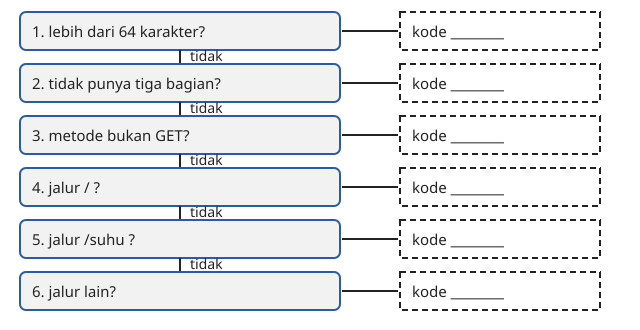

**Ingat dulu:** Tanpa melihat catatan, jawab. (1) Mengapa penerima memakai penyangga berukuran tetap dan membuang baris yang terlalu panjang, bukan menumbuhkannya? ______ (2) Dua perangkat berada di jaringan yang sama bila bagian mana dari alamat IP mereka sama? ______



`[Gambar: enam kotak pemeriksaan bersusun dari atas ke bawah, masing-masing bertanya: lebih dari 64 karakter, punya tiga bagian, metode GET, jalur /, jalur /suhu, dan selain itu. Di kanan tiap kotak ada kotak putus-putus bertuliskan "kode" dengan garis kosong, tempat kamu menulis kode jawabannya.]`

**Prediksi:** Tebak dulu, tulis jawabanmu, baru jalankan. Fungsi `tangani` menerima baris pertama permintaan. Aturannya ada pada gambar; jalur `/` dan `/suhu` dijawab `200`, dan halaman 404 menyalin jalur ke dalam HTML. Isi kotak kode pada gambar, lalu jawab: berapa kode untuk `GET /suhu HTTP/1.1` ______, `POST /suhu HTTP/1.1` ______, `GET /angin HTTP/1.1` ______, dan baris `GET /` diikuti 70 huruf `a` lalu ` HTTP/1.1` ______? Pada permintaan `GET /<b>x HTTP/1.1`, apa yang sebaiknya tertulis di halaman 404, dan apa risikonya bila jalur disalin apa adanya? ______

**Lengkapi:** Tambahkan jalur `/lembap` yang menjawab `200` dengan kelembapan karangan `60`, dan jawab `404` untuk jalur lain. Isi bagian `____`.

```cpp setengah-jadi
// C++17. Lengkapi bagian ____.
#include <string>

struct Jawaban {
  int kode;
  std::string jenis;
  std::string isi;
};

Jawaban rute(const std::string &jalur) {
  if (jalur == "/suhu") {
    return {200, "text/plain", "27.5"};
  }
  if (jalur == ____) {
    return {200, "text/plain", ____};
  }
  return {____, "text/plain", "Tidak ditemukan"};
}
```

**Susun:** Susun baris A sampai G menjadi `setup()` server: mulai Serial, daftarkan jalur, baru jalankan server.

```text
(A)   server.begin();
(B) void setup() {
(C)   Serial.begin(115200);
(D)   server.on("/", halamanUtama);
(E)   server.on("/suhu", jalurSuhu);
(F)   server.onNotFound(tidakAda);
(G) }
```

Urutan: ______ ______ ______ ______ ______ ______ ______

**Latihan:**

1. `AI: tanpa AI` Program contoh menerima `GET /suhu?x=1 HTTP/1.1`. Berapa kode jawabannya, dan mengapa? Bagaimana memperbaikinya? ______
2. `AI: boleh` Tulis pseudocode lalu tambahkan jalur `/lembap`, beserta satu halaman `/` yang menampilkan suhu dan kelembapan. ______
3. `AI: tanpa AI` Mengapa `<` diubah menjadi `&lt;` sebelum jalur dimasukkan ke halaman? ______

**Cek diri:**

- [ ] Saya menulis jawaban 200, 404, dan 405 serta menolak permintaan terlalu panjang.
- [ ] Saya meloloskan teks dari luar sebelum memasukkannya ke halaman.
- [ ] Saya tahu server mini tidak dibuka ke internet.

**Catatan cetak (untuk guru, tidak dicetak):** dua halaman A4. Kunci ada di modul `c-xi2-m4`, bagian "Kunci dan petunjuk". Lembar tidak memuat kolom identitas.
