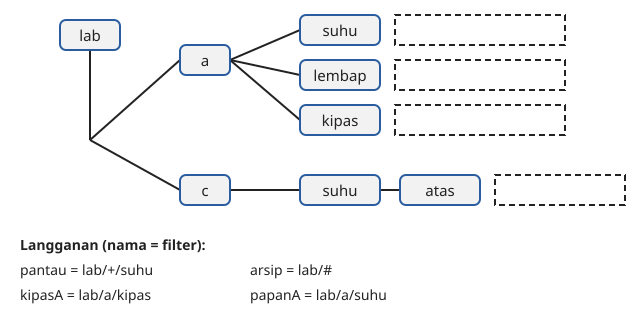

**Ingat dulu:** Tanpa melihat catatan, jawab. (1) Mengapa pengirim dan penerima harus sepakat pada format pesan, dan apa yang terjadi bila tidak? ______ (2) Mengapa teks dari luar harus diloloskan sebelum dimasukkan ke halaman HTML? ______



`[Gambar: pohon topik. Akar "lab" bercabang ke "a" dan "c". Cabang "a" punya daun "suhu", "lembap", dan "kipas". Cabang "c" punya "suhu", dan di bawahnya "atas". Di samping tiap daun ada kotak kosong untuk menulis nama langganan yang menerimanya. Di bawah pohon tertulis empat langganan: pantau = lab/+/suhu, arsip = lab/#, kipasA = lab/a/kipas, papanA = lab/a/suhu.]`

**Prediksi:** Tebak dulu, tulis jawabanmu, baru jalankan. Broker karangan menyimpan empat langganan seperti pada gambar. Karakter `+` mewakili tepat satu tingkat topik; `#` mewakili semua tingkat sisanya dan hanya ditulis di akhir. Tingkat dipisahkan garis miring. (1) Siapa saja yang menerima pesan bertopik `lab/a/suhu`? ______ (2) Siapa yang menerima `lab/a/lembap`? ______ Dan `lab/c/suhu/atas`? ______ (3) Siapa yang menerima `LAB/a/suhu` (huruf besar)? ______ Dan `ruang/a/suhu`? ______ Tulis jawaban (1) dan (2) pada kotak di samping daun pohon.

**Lengkapi:** `f` adalah filter dan `t` adalah topik yang sudah dipecah per tingkat. Isi bagian `____`.

```cpp setengah-jadi
// C++17. Lengkapi bagian ____.
#include <string>
#include <vector>

bool cocok(const std::vector<std::string> &f, const std::vector<std::string> &t) {
  for (size_t i = 0; i < f.size(); i++) {
    if (f[i] == "____") {
      return true;
    }
    if (i >= t.size()) {
      return ____;
    }
    if (f[i] != "____" && f[i] != t[i]) {
      return false;
    }
  }
  return f.size() == ____;
}
```

**Susun:** Susun baris A sampai G menjadi `terbitkan`: untuk tiap langganan, bila filternya cocok, cetak nama pelanggan. Indentasi menunjukkan tingkat bersarang.

```text
(A)   }
(B) void terbitkan(const std::string &topik, const std::string &pesan) {
(C)     if (cocok(l.filter, topik)) {
(D)   for (const Langganan &l : daftar) {
(E)       std::cout << "  -> " << l.pelanggan << "\n";
(F)     }
(G) }
```

Urutan: ______ ______ ______ ______ ______ ______ ______

**Latihan:**

1. `AI: tanpa AI` Topik mana yang cocok dengan filter `lab/+/suhu`: `lab/a/suhu`, `lab/a/b/suhu`, `lab/suhu`, `kelas/a/suhu`, `lab/c/suhu`? ______
2. `AI: boleh` Sebuah sistem punya dua ruang (`a` dan `b`) dengan masing-masing sensor `suhu` dan `lembap`. Tulis rancangan topik, filter untuk "semua suhu dari semua ruang" dan "semua data ruang b", lalu gambar diagram alir pesannya. ______
3. `AI: tanpa AI` Mengapa broker disebut titik kegagalan tunggal? Sebut satu akibat bagi sistem kelompokmu. ______

**Cek diri:**

- [ ] Saya dapat menjelaskan penerbit, pelanggan, topik, dan broker.
- [ ] Saya dapat menentukan topik yang cocok dengan filter yang memakai `+` dan `#`.
- [ ] Saya dapat menyebut titik kegagalan tunggal dan risiko keamanan broker.

**Catatan cetak (untuk guru, tidak dicetak):** dua halaman A4. Kunci ada di modul `c-xi2-m5`, bagian "Kunci dan petunjuk". Lembar tidak memuat kolom identitas.
