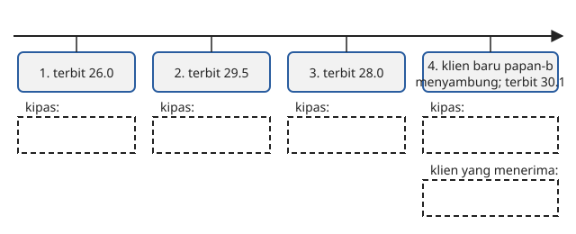

**Ingat dulu:** Tanpa melihat catatan, jawab. (1) Bila penerima tidak menerima apa pun, apa dua dugaan pertama, dan bagaimana membedakannya dengan satu pengamatan? ______ (2) Siapa yang menentukan penerima sebuah pesan: penerbit atau broker? ______



`[Gambar: garis waktu dengan empat kejadian berurutan: terbit 26.0, terbit 29.5, terbit 28.0, lalu klien baru ber-ID papan-b menyambung dan terbit 30.1. Di bawah tiap kejadian ada kotak kosong "kipas" dan, di bawah kejadian keempat, kotak kosong "klien yang menerima".]`

**Prediksi:** Tebak dulu, tulis jawabanmu, baru jalankan. Papan B berlangganan `lab/a/suhu` dan menyalakan kipas bila suhu **lebih dari** 28,0. Sebuah penerbit menerbitkan berturut-turut `26.0`, `29.5`, dan `28.0`. Setelah itu klien baru dengan ID `papan-b` yang sama menyambung, lalu penerbit menerbitkan `30.1`. Isi kotak pada gambar. Ada pula pemanggil balik yang salah: ia mencetak isi pesan tanpa memakai panjang, padahal sisa penyangga berisi tanda `#`. Apa yang terjadi pada klien lama saat klien baru ber-ID sama menyambung? ______ Apa yang dicetak versi yang salah untuk pesan `26.0`? ______

**Lengkapi:** Salin paling banyak 15 byte pesan, lalu akhiri dengan nol. Isi bagian `____`.

```cpp setengah-jadi
// C++17. Lengkapi bagian ____.
#include <cstdint>
#include <cstring>

void saatPesan(char *topik, uint8_t *isi, unsigned int panjang) {
  (void)topik;
  char salinan[16];
  unsigned int n = panjang < sizeof(salinan) - ____ ? panjang : sizeof(salinan) - ____;
  memcpy(salinan, isi, ____);
  salinan[n] = ____;
}
```

**Susun:** Susun baris A sampai L menjadi `loop()` papan B: bila belum tersambung, coba menyambung tiap 5 detik lalu berlangganan; bila sudah tersambung, jalankan `klien.loop()`. Indentasi menunjukkan bersarang.

```text
(A)   klien.loop();
(B) void loop() {
(C)   if (!klien.connected()) {
(D)     if (millis() - terakhirCoba >= 5000) {
(E)       terakhirCoba = millis();
(F)       if (klien.connect(ID_KLIEN)) {
(G)         klien.subscribe(TOPIK);
(H)       }
(I)     }
(J)     return;
(K)   }
(L) }
```

Urutan: ______ ______ ______ ______ ______ ______ ______ ______ ______ ______ ______ ______

**Latihan:**

1. `AI: tanpa AI` Pada pemanggil balik papan B, apa keadaan kipas untuk pesan `28.5`, `28.0`, dan pesan kosong? Apa risiko `atof` mengembalikan 0 untuk teks yang bukan angka? ______
2. `AI: boleh` Tulis pseudocode, lalu rancang topik dan program penerbit serta pelanggan untuk kelompokmu: topik memuat nomor kelompok (mis. `lab/k3/suhu`) supaya tidak bertabrakan, dan ID klien unik. ______
3. `AI: tanpa AI` Apa akibatnya bila papan A dan papan B memakai ID klien yang sama, dan bagaimana gejalanya terlihat? ______

**Cek diri:**

- [ ] Saya dapat menulis penerbit dan pelanggan dengan topik dan ID klien unik.
- [ ] Saya menyalin isi pesan dengan panjang yang diketahui sebelum dipakai sebagai teks.
- [ ] Saya menyambung ulang dengan jeda dan tidak memblokir program.

**Catatan cetak (untuk guru, tidak dicetak):** dua halaman A4. Kunci ada di modul `c-xi2-m6`, bagian "Kunci dan petunjuk". Lembar tidak memuat kolom identitas.
