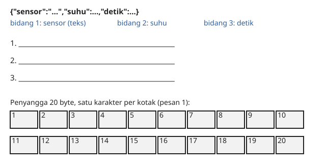

**Ingat dulu:** Tanpa melihat catatan, jawab. (1) Apa kelebihan pesan berbentuk teks yang bisa dibaca manusia dibanding biner saat memecahkan masalah? ______ (2) Mengapa isi pesan dari pustaka harus disalin dengan panjang yang diketahui sebelum dipakai sebagai teks? ______



`[Gambar: bentuk pesan {"sensor":"...","suhu":...,"detik":...} dengan tiga bidang diberi label. Di bawahnya tiga baris isian kosong bernomor 1 sampai 3 untuk menulis pesan tiap pembacaan, lalu dua baris penyangga masing-masing sepuluh kotak, bernomor 1 sampai 20, untuk menulis karakter pesan pertama satu per satu.]`

**Prediksi:** Tebak dulu, tulis jawabanmu, baru jalankan. Fungsi `bentukJson` menyusun pesan seperti pada gambar dengan suhu satu desimal. Bila suhu tidak valid (`NaN`), nilainya ditulis `null`. Tanda kutip dalam nama sensor diloloskan dengan garis miring terbalik. Pembacaan karangan: (`s01`, 27,5, 120 detik), (`s01`, tidak valid, 125 detik), dan (sensor bernama `lab "A"`, 26,04, 130 detik). (1) Tulis pesan untuk ketiga pembacaan itu pada gambar. (2) Muatkah pesan pertama di penyangga 20 byte? ______ Berapa karakter panjangnya? ______ (3) Bila `NaN` dicetak dengan `%.1f` tanpa pemeriksaan, apa yang terjadi pada pesannya? ______

**Lengkapi:** Satu desimal, dan pesan dinyatakan muat hanya bila panjangnya kurang dari ukuran penyangga. Isi bagian `____`.

```cpp setengah-jadi
// C++17. Lengkapi bagian ____.
#include <cstdio>

bool bentukJson(double lembap, char *keluar, size_t ukuran) {
  int n = snprintf(keluar, ukuran, "{\"lembap\":%.____f}", lembap);
  return n > 0 && static_cast<size_t>(n) ____ ukuran;
}
```

**Susun:** Susun baris A sampai I menjadi `bentukJson`: nilai hilang ditulis `null`, nilai ada ditulis dengan satu desimal, lalu laporkan apakah muat.

```text
(A)   int n;
(B) bool bentukJson(const char* sensor, float suhu, unsigned long detik, char* keluar, size_t ukuran) {
(C)   if (isnan(suhu)) {
(D)     n = snprintf(keluar, ukuran, "{\"sensor\":\"%s\",\"suhu\":null,\"detik\":%lu}", sensor, detik);
(E)   } else {
(F)     n = snprintf(keluar, ukuran, "{\"sensor\":\"%s\",\"suhu\":%.1f,\"detik\":%lu}", sensor, suhu, detik);
(G)   }
(H)   return n > 0 && (size_t)n < ukuran;
(I) }
```

Urutan: ______ ______ ______ ______ ______ ______ ______ ______ ______

**Latihan:**

1. `AI: tanpa AI` Tulis pesan JSON untuk pembacaan (`s02`, 31,3, 200 detik) dan untuk pembacaan `s02` yang gagal dibaca pada detik 205. Berapa karakter panjang pesan yang pertama? ______
2. `AI: boleh` Tulis pseudocode lalu ubah program agar pesan memuat satu bidang bilangan bulat `lembap` (persen). Sebutkan tiga kasus uji, termasuk satu pesan yang harus dinyatakan terpotong. ______
3. `AI: tanpa AI` Mengapa keempat teks ini bukan JSON sah: `{'suhu':27.5}`, `{"suhu":27.5,}`, `{"suhu":nan}`, dan `{suhu:27.5}`? ______

**Cek diri:**

- [ ] Saya dapat menulis pembacaan sensor sebagai pesan JSON.
- [ ] Saya meloloskan tanda kutip dan memeriksa bahwa pesan muat di penyangga.
- [ ] Saya dapat menunjukkan mengapa sebuah teks bukan JSON sah.

**Catatan cetak (untuk guru, tidak dicetak):** dua halaman A4. Kunci ada di modul `c-xi2-m7`, bagian "Kunci dan petunjuk". Lembar tidak memuat kolom identitas.
