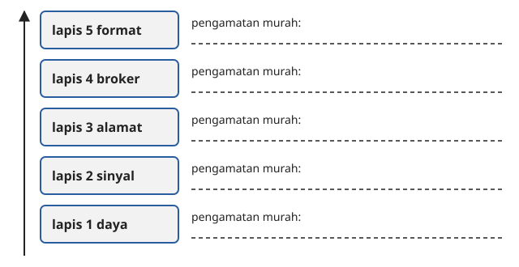

**Ingat dulu:** Tanpa melihat catatan, jawab. (1) Urutkan lima tahap diagnosis jaringan dari fisik sampai layanan. ______ (2) Apa beda `+` dan `#` pada filter topik? Beri satu contoh masing-masing. ______ (3) Mengapa suhu yang gagal dibaca ditulis `null`, bukan `nan` atau 0? ______



`[Gambar: lima kotak bersusun dari bawah ke atas dengan panah ke atas: lapis 1 daya, lapis 2 sinyal, lapis 3 alamat, lapis 4 broker, lapis 5 format. Di kanan tiap kotak ada garis isian untuk menulis satu pengamatan murah yang kamu pakai memeriksa lapis itu.]`

**Prediksi:** Tebak dulu, tulis jawabanmu, baru jalankan. Program memeriksa pengamatan dari lapis paling dasar dulu dan melaporkan lapis pertama yang bermasalah. RSSI makin negatif makin lemah; ambang lemah di program `-80`.

| Kasus | Daya | Wi-Fi | RSSI | Punya IP | Sejaringan dengan broker | Broker menerima | Pesan terakhir | Lapis pertama bermasalah |
| --- | --- | --- | --- | --- | --- | --- | --- | --- |
| 1 | ya | tidak | -60 | tidak | tidak | tidak | (kosong) | |
| 2 | ya | ya | -85 | ya | ya | ya | `{"suhu":27.5}` | |
| 3 | ya | ya | -55 | ya | tidak | tidak | `{"suhu":27.5}` | |
| 4 | ya | ya | -55 | ya | ya | tidak | `{"suhu":27.5}` | |
| 5 | ya | ya | -55 | ya | ya | ya | `{"suhu":nan}` | |

Pada nomor 2 semua lapis berikutnya sehat. Mengapa program tetap menandai lapis sinyal? ______ Bila nomor 1 diperbaiki sehingga Wi-Fi tersambung, apakah lapis berikutnya pasti sehat? ______

**Lengkapi:** Isi bagian `____` pada fungsi untuk tiga lapis tengah. Setiap pemeriksaan hanya boleh dicapai bila lapis di bawahnya lolos.

```cpp setengah-jadi
// C++17. Lengkapi bagian ____.
#include <string>

std::string lapisAlamat(bool wifiTersambung, bool punyaAlamat, bool sejaringanBroker) {
  if (____wifiTersambung) return "sinyal";
  if (!punyaAlamat) return "____";
  if (____) return "alamat (beda jaringan)";
  return "broker";
}
```

**Susun:** Susun baris A sampai G menjadi fungsi yang memeriksa lapis dari yang paling dasar ke yang paling atas.

```text
(A)   if (!p.punyaAlamat) return "alamat";
(B) }
(C)   return "tidak ada";
(D)   if (!p.dayaMenyala) return "daya";
(E) std::string lapisBermasalah(const Pengamatan &p) {
(F)   if (!p.brokerMenerima) return "broker";
(G)   if (!p.wifiTersambung) return "sinyal";
```

Urutan: ______ ______ ______ ______ ______ ______ ______

**Latihan:**

1. `AI: tanpa AI` Untuk tiap kasus, tulis lapis pertama yang bermasalah dan satu pengamatan yang membuktikannya: (a) lampu daya padam; (b) Wi-Fi tersambung, alamat `0.0.0.0`; (c) alamat papan `192.0.2.23/24`, alamat broker `192.0.2.10`, broker menolak sambungan; (d) semuanya sehat tetapi penerima menolak pesan `{'suhu':27.5}`. ______
2. `AI: tanpa AI` Gangguan: papan tersambung dan punya alamat, tetapi pelanggan di komputer guru tidak menerima apa pun. Tulis catatan lima baris (dugaan, satu pengamatan, hasil, tindakan), dengan satu perubahan pada satu waktu, untuk penyebab "ID klien dipakai dua papan". ______

**Cek diri:**

- [ ] Saya dapat menyebut urutan diagnosis: daya, sinyal, alamat, broker, format.
- [ ] Saya mengubah satu hal pada satu waktu dan mencatatnya.
- [ ] Saya dapat menjelaskan mengapa pesan salah bentuk tetap diterima broker.

**Catatan cetak (untuk guru, tidak dicetak):** dua halaman A4. Kunci ada di modul `c-xi2-m8`, bagian "Kunci dan petunjuk". Lembar tidak memuat kolom identitas.
