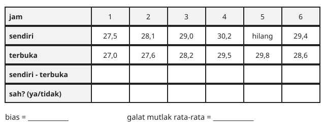

**Ingat dulu:** Tanpa melihat catatan, jawab. (1) Apa yang terjadi bila dua papan memakai ID klien yang sama? ______ (2) Mengapa mengubah satu hal pada satu waktu membuat penyebab gangguan lebih mudah ditemukan? ______ (3) Mengapa alamat IP papan bisa berbeda setelah dinyalakan ulang? ______



`[Gambar: tabel dengan kolom jam 1 sampai 6 dan empat baris. Baris "sendiri" berisi 27,5; 28,1; 29,0; 30,2; hilang; 29,4. Baris "terbuka" berisi 27,0; 27,6; 28,2; 29,5; 29,8; 28,6. Baris "sendiri - terbuka" dan baris "sah? (ya/tidak)" kosong untuk kamu isi. Di bawahnya ada garis isian untuk bias dan galat mutlak rata-rata.]`

**Prediksi:** Tebak dulu, tulis jawabanmu, baru jalankan. Program membandingkan suhu per jam dari sensor sendiri dengan data terbuka (keduanya karangan, pada gambar). Pada jam ke-4 sensor sendiri gagal dibaca (`NAN`). Program melewati pasangan yang salah satunya hilang, lalu menghitung **bias** (rata-rata `sendiri - terbuka`) dan galat mutlak rata-rata. (1) Berapa pasangan yang sah? ______ (2) Apakah bias positif atau negatif? ______ Sensor sendiri cenderung membaca lebih tinggi atau lebih rendah? ______ (3) Bila pasangan yang hilang tidak dilewati dan `NAN` ikut dijumlahkan, berapa hasil bias? ______ Isi baris kosong pada gambar.

**Lengkapi:** `bias` harus melewati pasangan yang hilang dan mengembalikan `NAN` bila tidak ada pasangan sah. Isi bagian `____`.

```cpp setengah-jadi
// C++17. Lengkapi bagian ____.
#include <cmath>

double bias(const double a[], const double b[], int n) {
  double jumlah = 0;
  int sah = 0;
  for (int i = 0; i < n; i++) {
    if (std::isnan(a[i]) ____ std::isnan(b[i])) continue;
    jumlah += a[i] ____ b[i];
    sah++;
  }
  return sah == 0 ? ____ : jumlah / sah;
}
```

**Susun:** Susun baris A sampai F menjadi fungsi `dalamToleransi`: pasangan yang hilang dinyatakan tidak dalam toleransi.

```text
(A)   return std::fabs(sendiri - terbuka) <= TOLERANSI;
(B)   if (std::isnan(sendiri) || std::isnan(terbuka)) {
(C) }
(D)     return false;
(E) bool dalamToleransi(double sendiri, double terbuka) {
(F)   }
```

Urutan: ______ ______ ______ ______ ______ ______

**Latihan:**

1. `AI: tanpa AI` Untuk tiap keterangan, tulis apa yang kamu lakukan sebelum memakai datanya di laporan: (a) "CC BY 4.0"; (b) "bebas dipakai, tidak boleh diubah"; (c) tidak ada keterangan lisensi. ______
2. `AI: tanpa AI` Pasangan (sendiri, terbuka): (26,0; 25,5), (27,0; 27,2), (hilang; 28,0), (28,5; 27,9). Hitung bias, galat mutlak rata-rata, dan berapa pasangan dalam toleransi 0,5. ______
3. `AI: boleh` Tulis pseudocode lalu tambahkan ke program perbandingan: jam dengan selisih mutlak terbesar beserta nilainya. Sebutkan tiga kasus uji, termasuk semua pasangan hilang. ______

**Cek diri:**

- [ ] Saya dapat membedakan data yang bisa diunduh dari data yang boleh dipakai dan dibagikan.
- [ ] Saya menghitung bias dan galat tanpa memasukkan pasangan yang hilang.
- [ ] Saya menulis catatan sumber yang lengkap.

**Catatan cetak (untuk guru, tidak dicetak):** dua halaman A4. Kunci ada di modul `c-xi2-m9`, bagian "Kunci dan petunjuk". Lembar tidak memuat kolom identitas.
