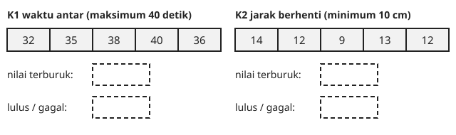

**Ingat dulu:** Tanpa melihat catatan, jawab. (1) Apa kelebihan dan kekurangan JSON dibanding format biner untuk data sensor? ______ (2) Apa beda kebutuhan dan rancangan? Beri satu kalimat untuk masing-masing pada pemantau suhu. ______



`[Gambar: dua tabel hasil uji, masing-masing lima hasil. K1 waktu antar, maksimum 40 detik: 32, 35, 38, 40, 36. K2 jarak berhenti, minimum 10 cm: 14, 12, 9, 13, 12. Di bawah tiap tabel ada kotak kosong "nilai terburuk" dan "lulus atau gagal".]`

**Prediksi:** Tebak dulu, tulis jawabanmu, baru jalankan. Jenis `MAKSIMUM` berarti semua hasil harus kurang dari atau sama dengan batas; `MINIMUM` berarti semua hasil harus lebih dari atau sama dengan batas. (1) Isi kotak pada gambar untuk K1 dan K2: apa yang lulus dan apa yang gagal, dan berapa nilai terburuknya? ______ (2) Pengguna berkata "robotnya harus cepat". Bisakah kalimat itu diuji apa adanya? ______ Bila tidak, tulis ulang menjadi kalimat yang bisa diuji. ______

**Lengkapi:** Kebutuhan yang belum diuji tidak lulus; `MAKSIMUM` memakai kurang dari atau sama dengan, `MINIMUM` lebih dari atau sama dengan. Isi bagian `____`.

```cpp setengah-jadi
// C++17. Lengkapi bagian ____.
bool lulus(const Kebutuhan &k, const HasilUji &h) {
  if (h.jumlah ____ 0) {
    return ____;
  }
  int terburuk = nilaiTerburuk(k, h);
  return k.jenis == Jenis::MAKSIMUM ? terburuk ____ k.batas : terburuk ____ k.batas;
}
```

**Susun:** Susun baris A sampai H menjadi fungsi `nilaiTerburuk`. Dua baris `if` di dalam perulangan boleh bertukar tempat.

```text
(A)   int terburuk = h.nilai[0];
(B) int nilaiTerburuk(const Kebutuhan &k, const HasilUji &h) {
(C)   for (int i = 1; i < h.jumlah; i++) {
(D)     if (k.jenis == Jenis::MAKSIMUM && h.nilai[i] > terburuk) { terburuk = h.nilai[i]; }
(E)     if (k.jenis == Jenis::MINIMUM && h.nilai[i] < terburuk) { terburuk = h.nilai[i]; }
(F)   }
(G)   return terburuk;
(H) }
```

Urutan: ______ ______ ______ ______ ______ ______ ______ ______

**Latihan:**

1. `AI: tanpa AI` Untuk tiap pernyataan, tulis kebutuhan, batasan, atau rancangan: (a) robot memakai sensor ultrasonik; (b) daya hanya dari baterai AA yang disediakan guru; (c) robot berhenti sebelum menabrak halangan; (d) robot tidak memakai kamera; (e) robot memakai dua motor DC. ______
2. `AI: tanpa AI` Tulis satu kebutuhan keselamatan untuk "baterai hampir habis" beserta cara mengujinya tanpa merusak apa pun. ______
3. `AI: boleh` Ubah kalimat pengguna fiktif "robotnya harus kuat mengangkut" menjadi kebutuhan dengan angka dan cara uji. ______

**Cek diri:**

- [ ] Saya dapat mengubah kalimat pengguna menjadi kebutuhan dengan angka dan cara uji.
- [ ] Saya dapat membedakan kebutuhan, batasan, dan rancangan.
- [ ] Saya menulis paling sedikit satu kebutuhan keselamatan.

**Catatan cetak (untuk guru, tidak dicetak):** dua halaman A4. Kunci ada di modul `c-xii1-m1`, bagian "Kunci dan petunjuk". Lembar tidak memuat kolom identitas.
