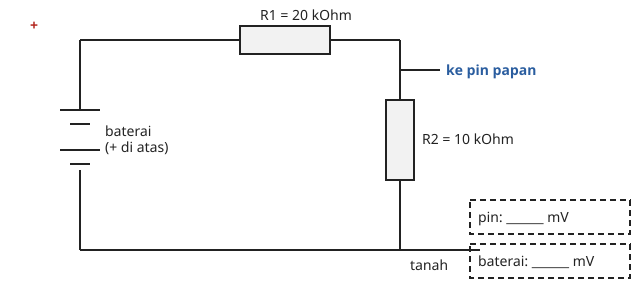

**Ingat dulu:** Tanpa melihat catatan, jawab. (1) Mengapa hitungan waktu operasi tidak memakai seluruh kapasitas baterai? ______ (2) Mengapa hasil uji dicatat bersama kondisi baterai dan lintasannya? ______



`[Gambar: rangkaian pembagi tegangan. Dari terminal positif baterai ada resistor R1 20 kOhm menuju satu titik, dari titik itu resistor R2 10 kOhm menuju tanah, dan dari titik itu ada garis ke pin papan. Di samping ada kotak kosong untuk mV di pin dan mV di baterai.]`

**Prediksi:** Tebak dulu, tulis jawabanmu, baru telusuri. Empat sel AA diberi pembagi tegangan seperti pada gambar; pin hanya melihat R2 / (R1 + R2). Contoh kalibrasi: bacaan mentah 1850 sama dengan 1500 mV di pin, dan 2480 sama dengan 2000 mV. Ambang contoh: NORMAL bila baterai 5200 mV atau lebih, LEMAH bila 4600 sampai 5199, BERHENTI di bawahnya. (1) Berapa persen dari tegangan baterai yang sampai ke pin, dan mengapa pembagi diperlukan? ______ (2) Bacaan mentah 2480 berarti berapa mV di pin, dan berapa mV di baterai? ______ (3) Robot berarus rata-rata kecil lolos uji waktu operasi. Apakah itu cukup untuk menyebutnya aman? Apa lagi yang perlu diperiksa? ______

**Lengkapi:** Tegangan baterai dari tegangan pin dengan kedua resistor, dan arus macet aman bila tidak melebihi batas pengendali. Isi bagian `____`.

```cpp setengah-jadi
// C++17. Lengkapi bagian ____.
int mvBaterai(int mvPin) { return mvPin * (____ + R2_OHM) / ____; }

bool arusMacetAman(const Rencana &r) { return r.arusMacetMa ____ r.batasPengendaliMa; }
```

**Susun:** Susun baris A sampai F menjadi perulangan tabel status. Tiap baris memakai hasil baris sebelumnya.

```text
(A)   Status s = statusDaya(mvBat);
(B) for (int raw : {2480, 2160, 1950}) {
(C)   int mvPin = rawKeMvPin(raw);
(D) }
(E)   std::cout << raw << " " << mvBat << " " << namaStatus(s) << "\n";
(F)   int mvBat = mvBaterai(mvPin);
```

Urutan: ______ ______ ______ ______ ______ ______

**Latihan:**

1. `AI: tanpa AI` Dengan kalibrasi contoh, bacaan mentah 2000 berarti berapa mV di pin dan di baterai, dan apa statusnya? ______
2. `AI: tanpa AI` Bila R1 = R2 = 10 kOhm dan baterai baru 6400 mV, berapa mV di pin? ______ Apakah lolos batas 3100 mV? ______ Apa perbaikannya? ______
3. `AI: boleh` Tulis dua alasan keputusan BERHENTI sebaiknya terkunci, bukan membuka sendiri saat tegangan naik lagi. ______

**Cek diri:**

- [ ] Saya menghitung tegangan baterai dari bacaan ADC dengan pembagi dan kalibrasi.
- [ ] Saya membuat robot berhenti sendiri dan terkunci sampai manusia membukanya.
- [ ] Saya menandai angka yang berasal dari contoh dan mengambil angka asli dari lembar data.

**Catatan cetak (untuk guru, tidak dicetak):** dua halaman A4. Kunci ada di modul `c-xii1-m10`, bagian "Kunci dan petunjuk". Lembar tidak memuat kolom identitas.
