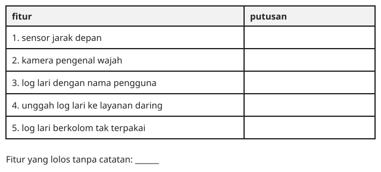

**Ingat dulu:** Tanpa melihat catatan, jawab. (1) Sebut dua aturan keselamatan saat menguji robot yang bergerak. ______ (2) Mengapa tegangan baterai harus dibagi sebelum masuk ke pin ADC? ______



`[Gambar: tabel dua kolom. Kolom kiri berisi lima fitur: sensor jarak depan; kamera pengenal wajah; log lari dengan nama pengguna; unggah log lari ke layanan daring; log lari berkolom tak terpakai. Kolom kanan "putusan" kosong, tempat kamu menulis DITOLAK, TINJAU, KURANGI, atau LOLOS. Di bawahnya satu kotak "berapa fitur yang lolos tanpa catatan".]`

**Prediksi:** Tebak dulu, tulis jawabanmu, baru jalankan. Lima fitur karangan diperiksa seperti pada gambar. Putusannya DITOLAK, TINJAU, KURANGI, atau LOLOS. (1) Isi putusan untuk tiap fitur pada gambar, lalu tulis berapa yang lolos tanpa catatan. ______ (2) Mengapa unggah log ke layanan daring perlu ditinjau walau tampak tanpa nama? ______

**Lengkapi:** Perangkat yang merekam orang ditolak lebih dulu, pengenal atau pengiriman keluar ditinjau, dan kolom tak terpakai dikurangi. Isi bagian `____`.

```cpp setengah-jadi
// C++17. Lengkapi bagian ____.
Putusan putuskan(const Fitur &f) {
  if (f.____) { return DITOLAK; }
  if (f.menyimpanPengenal ____ f.dikirimKeluar) { return TINJAU; }
  if (f.lebihDariPerlu) { return ____; }
  return LOLOS;
}
```

**Susun:** Susun baris A sampai E menjadi fungsi `putuskan`. Aturan yang paling berat harus diperiksa lebih dulu.

```text
(A)   if (f.lebihDariPerlu) { return KURANGI; }
(B) Putusan putuskan(const Fitur &f) {
(C)   if (f.merekamOrang) { return DITOLAK; }
(D)   return LOLOS;
(E) }
(F)   if (f.menyimpanPengenal || f.dikirimKeluar) { return TINJAU; }
```

Urutan: ______ ______ ______ ______ ______ ______

**Latihan:**

1. `AI: tanpa AI` Tandai tiap data berikut sebagai spesifik, umum, atau bukan data pribadi selama tidak dikaitkan ke orang: (a) catatan kesehatan peserta lomba; (b) nama lengkap pengguna robot; (c) jarak halangan di lorong; (d) data anak. ______
2. `AI: tanpa AI` Beri putusan untuk: kamera yang menghitung orang lewat; log lari berisi nama dan jam; sensor suhu ruang tanpa pengenal. ______
3. `AI: tanpa AI` Seorang teman mengusulkan memasang mikrofon agar robot "mendengar perintah" saat pameran. Tulis dua alasan menolaknya dan satu alternatif tanpa merekam. ______

**Cek diri:**

- [ ] Saya dapat menjelaskan data pribadi, jenis umum dan spesifik.
- [ ] Saya menulis catatan kepatuhan dengan putusan dan alasan.
- [ ] Saya tidak merekam orang dengan kamera, mikrofon, atau sensor tubuh.

**Catatan cetak (untuk guru, tidak dicetak):** dua halaman A4. Kunci ada di modul `c-xii1-m11`, bagian "Kunci dan petunjuk". Lembar tidak memuat kolom identitas.
