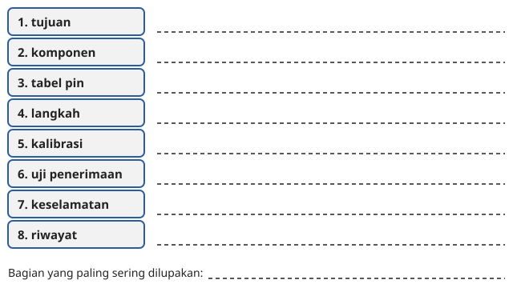

**Ingat dulu:** Tanpa melihat catatan, jawab. (1) Catatan apa yang harus ada dalam dokumen perakitan agar orang lain dapat mengulang kalibrasi sensor garis? ______ (2) Mengapa tabel hasil uji menyimpan setiap percobaan, bukan hanya rata-ratanya? ______



`[Gambar: daftar delapan bagian dokumen perakitan: tujuan, komponen, tabel pin, langkah, kalibrasi, uji penerimaan, keselamatan, dan riwayat. Di kanan tiap bagian ada garis isian untuk satu kalimat isinya, dan di bawahnya satu garis untuk bagian yang paling sering dilupakan.]`

**Prediksi:** Tebak dulu, tulis jawabanmu, baru jalankan. Seorang murid menambahkan lampu status ke robot tanpa membuka tabel pin. Ia memakai pin 16, padahal pin itu sudah dipakai `KIRI_IN2`. (1) Apa yang akan terjadi pada motor kiri saat lampu status dinyalakan? ______ (2) Kapan sebaiknya kesalahan ini ketahuan: saat robot jalan, atau sebelum diunggah? Bagaimana? ______ (3) Dari delapan bagian pada gambar, bagian mana yang menurutmu paling sering dilupakan? ______

**Lengkapi:** `adaKembar` membandingkan setiap pin hanya dengan pin sesudahnya, supaya tidak membandingkan pin dengan dirinya sendiri atau memeriksa pasangan dua kali. Isi bagian `____`.

```cpp setengah-jadi
// C++17. Lengkapi bagian ____.
bool adaKembar(const Pin *p, int n, int &a, int &b) {
  for (int i = 0; i < n; i++) {
    for (int j = ____; j < n; j++) {
      if (p[i].____ == p[j].nomor) { a = i; b = ____; return true; }
    }
  }
  return false;
}
```

**Susun:** Susun baris A sampai E menjadi pencetak tabel pin dari daftar. Judul dan pemisah tabel dicetak sebelum baris data.

```text
(A)   std::cout << "| " << p.nama << " | " << p.nomor << " | " << p.fungsi << " |\n";
(B) std::cout << "| --- | --- | --- |\n";
(C) for (const Pin &p : ROBOT) {
(D) std::cout << "| bagian | pin | fungsi |\n";
(E) }
```

Urutan: ______ ______ ______ ______ ______

**Latihan:**

1. `AI: tanpa AI` Perbaiki langkah ini menjadi langkah yang dapat diikuti: "Pasang semua sensor dan motor lalu coba jalankan." Tulis paling sedikit empat langkah, masing-masing dengan satu aksi dan satu titik periksa. ______
2. `AI: tanpa AI` Tulis panduan pengguna lima baris: menyalakan, menjalankan, menghentikan, bila ada bagian panas atau berbau, dan kapan memanggil guru. ______
3. `AI: boleh` Ubah `TOMBOL_MULAI` menjadi pin 4. Prediksikan dulu keluaran pemeriksa pin kembar. ______

**Cek diri:**

- [ ] Saya menulis langkah dengan satu aksi dan satu titik periksa.
- [ ] Saya menulis uji penerimaan yang dapat dilihat hasilnya.
- [ ] Saya meminta orang lain mencoba panduanku.

**Catatan cetak (untuk guru, tidak dicetak):** dua halaman A4. Kunci ada di modul `c-xii1-m12`, bagian "Kunci dan petunjuk". Lembar tidak memuat kolom identitas.
