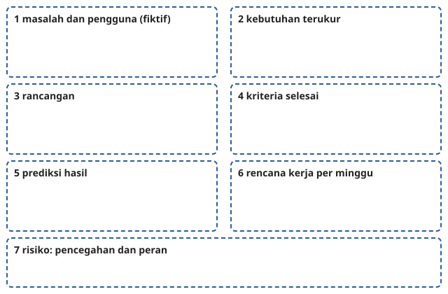

**Ingat dulu:** Tanpa melihat catatan, jawab. (1) Gambarkan diagram keadaan robot penghindar halangan dengan lima keadaan dan sebutkan syarat tiap panah. ______ (2) Sebut dua tanda baterai lemah yang harus membuat robot berhenti, bukan terus berjalan. ______ (3) Apa yang membuktikan sebuah rakitan benar, selain "sudah dipasang"? ______

`[Gambar: formulir rencana proyek dengan tujuh kotak berlabel: masalah dan pengguna (fiktif), kebutuhan terukur, rancangan, kriteria selesai, prediksi hasil, rencana kerja per minggu, dan risiko (dengan pencegahan dan peran). Tiap kotak kosong untuk kamu isi.]`

**Lengkapi:** Isi formulir pada gambar untuk proyek robotmu atau proyek karangan, dalam urutan ini. Tulis **prediksi sebelum merakit**. (1) Masalah dan pengguna fiktif dalam dua kalimat, tanpa orang nyata. (2) Tiga sampai lima kebutuhan dengan angka, satuan, dan cara ukur; tiap butir harus dapat gagal. (3) Rancangan: komponen, strategi, mesin keadaan, daya. (4) Kriteria selesai yang dapat diuji dan bisa gagal. (5) Prediksi hasil. (6) Rencana kerja per minggu dengan satu peran per tugas. (7) Risiko, masing-masing dengan tindakan pencegahan dan penanggung jawab. Periksa bahwa rencanamu tidak memuat sensor yang merekam orang atau data pribadi nyata.

**Latihan:**

1. `AI: tanpa AI` Tulis tiga sampai lima kebutuhan dengan angka, satuan, dan cara ukur untuk proyekmu. Titik periksa: tiap butir dapat gagal. ______
2. `AI: tanpa AI` Dari modul 8: ubah kebutuhan "robot harus stabil" menjadi syarat wajib yang dapat dihitung dari tabel hasil uji. ______
3. `AI: tanpa AI` Dari modul 10 dan 11: sebut satu butir lembar periksa daya dan satu butir catatan kepatuhan yang harus sudah ada di rencana sebelum merakit. ______
4. `AI: boleh` Tukar rencana dengan kelompok lain. Tulis tiga bagian masukan: satu yang sudah baik, satu yang perlu diperbaiki (sebut butir tertentu, misalnya "K4 tidak menyebut cara ukur"), dan satu langkah berikutnya. ______

**Cek diri:**

- [ ] Kebutuhanku punya angka, satuan, dan cara ukur.
- [ ] Kriteria selesaiku dapat gagal.
- [ ] Prediksiku ditulis sebelum mengerjakan.
- [ ] Setiap risiko punya pencegahan dan peran.

**Catatan cetak (untuk guru, tidak dicetak):** dua halaman A4. Bagian Prediksi dan Susun dilewati karena modul proyek tidak memuat soal prediksi berkode atau soal Parsons. Kunci ada di modul `c-xii1-m13`, bagian "Kunci dan petunjuk". Lembar tidak memuat kolom identitas.
