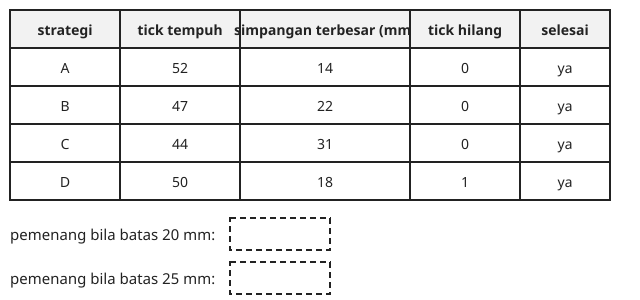

**Ingat dulu:** Tanpa melihat catatan, jawab. (1) Sebut dua ukuran yang dipakai untuk menilai pengikut garis dan satu kelemahan masing-masing. ______ (2) Kapan data dari sensor yang tampak biasa, seperti log jarak, menjadi data pribadi? ______ (3) Mengapa kedua strategi memakai benih atau titik awal yang sama pada tiap percobaan? ______ (4) Mengapa BERHENTI karena baterai lemah terkunci sampai manusia membukanya? ______

`[Gambar: tabel lima kolom: strategi, tick tempuh, simpangan terbesar (mm), tick hilang, selesai. Baris A: 52, 14, 0, ya. B: 47, 22, 0, ya. C: 44, 31, 0, ya. D: 50, 18, 1, ya. Di bawahnya dua kotak kosong: pemenang bila batas 20 mm dan pemenang bila batas 25 mm.]`

**Prediksi:** Tebak dulu, tulis jawabanmu, baru telusuri. Pemantau baterai memakai pembagi R1 = R2 = 10000 Ohm dan menghitung `mvBaterai(mvPin) = mvPin * (R1 + R2) / R2`. Status: BERHENTI bila di bawah 4600 mV, LEMAH bila 4600 sampai 5199 mV, NORMAL bila 5200 mV atau lebih.

| mvPin | mvBaterai | Status |
| --- | --- | --- |
| 2400 | | |
| 2300 | | |
| 2100 | | |

Bila baterai baru bertegangan 6400 mV dan batas aman di pin 3100 mV, apa yang perlu diperbaiki pada rancangan pembaginya? ______

**Latihan:** `AI: tanpa AI` (asesmen ini tanpa AI).

1. Pilih pemenang dari tabel pada gambar dengan syarat wajib "selesai, garis tidak hilang, simpangan terbesar paling banyak batas", lalu tick tempuh terkecil. Siapa pemenang bila batas 20 mm, dan bila batas 25 mm? ______ Jelaskan mengapa berubah. ______
2. Dua strategi diuji sepuluh kali dengan rata-rata simpangan terbesar yang hampir sama, tetapi terburuk 27 mm lawan 25 mm, dan batas kebutuhan 25 mm. Tulis dua kalimat laporan yang jujur dan satu uji tambahan yang kamu usulkan. ______
3. Beri putusan DITOLAK, TINJAU, KURANGI, atau LOLOS, dengan satu alasan: (a) mikrofon yang merekam suara penonton pameran; (b) log lari berisi nama dan jam; (c) sensor suhu ruang tanpa pengenal. ______
4. Dari masalah karangan "kotak komponen sering jatuh saat dipindahkan", tulis dua kebutuhan terukur dan satu kriteria selesai yang dapat gagal. ______

**Cek diri:**

- [ ] Saya memilih strategi dengan syarat wajib yang ditulis lebih dulu.
- [ ] Saya meringkas uji berulang dengan rata-rata dan nilai terburuk.
- [ ] Saya menulis kebutuhan dan kriteria yang dapat gagal.

**Catatan cetak (untuk guru, tidak dicetak):** dua halaman A4. Bagian Lengkapi dan Susun dilewati karena modul asesmen tidak memuat contoh setengah jadi atau soal Parsons. Kunci ada di modul `c-xii1-m14`, bagian "Kunci dan petunjuk". Lembar tidak memuat kolom identitas.
