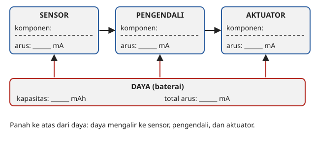

**Ingat dulu:** Tanpa melihat catatan, jawab. (1) Mengapa kebutuhan "robot harus cepat" tidak dapat diuji, dan bagaimana menulis ulang agar dapat diuji? ______ (2) Sebut dua alasan satu pembacaan tidak boleh langsung mengubah keputusan alat. ______



`[Gambar: diagram blok. Tiga kotak berurutan dengan panah: sensor, pengendali, aktuator. Di bawahnya satu kotak lebar "daya" dengan panah ke ketiganya. Di tiap kotak ada garis isian untuk nama komponen dan arus dalam mA, dan di bawah ada garis isian "total arus" dan "kapasitas baterai".]`

**Prediksi:** Tebak dulu, tulis jawabanmu, baru telusuri. Rumus perkiraan waktu operasi di program: `kapasitas * FAKTOR_PERSEN * 60 / (100 * arus)` dengan hasil dipotong ke menit bulat, dan `FAKTOR_PERSEN` bernilai 70 (asumsi: hanya sebagian kapasitas baterai terpakai). Susunan S berarus rata-rata total 500 mA dan berbaterai 800 mAh. (1) Berapa menit perkiraan waktu operasi S? ______ (2) Satu motor macet sehingga arus total naik menjadi 900 mA. Berapa menit sekarang? ______ (3) Mengapa angka ini hanya perkiraan kasar? ______

**Lengkapi:** Waktu operasi memakai `FAKTOR_PERSEN` dan pembagi 100, dan setiap syarat wajib mencoret bila tidak terpenuhi. Isi bagian `____`.

```cpp setengah-jadi
// C++17. Lengkapi bagian ____.
int menitOperasi(const Susunan &s) {
  return s.kapasitasMah * ____ * 60 / (____ * totalArusMa(s));
}

bool lolosSyarat(const Susunan &s) {
  if (menitOperasi(s) ____ BATAS_MENIT_MIN) { return false; }
  if (s.angkutGram ____ ANGKUT_MIN_GRAM) { return false; }
  if (s.massaGram ____ MASSA_MAKS_GRAM) { return false; }
  return true;
}
```

**Susun:** Susun baris A sampai G menjadi fungsi `totalArusMa`.

```text
(A)   total += s.komponen[i].arusMa;
(B) int totalArusMa(const Susunan &s) {
(C)   return total;
(D)   for (int i = 0; i < s.jumlah; i++) {
(E)   int total = 0;
(F)   }
(G) }
```

Urutan: ______ ______ ______ ______ ______ ______ ______

**Latihan:**

1. `AI: tanpa AI` Susunan berarus total 520 mA dan berbaterai 1500 mAh, `FAKTOR_PERSEN` 70. Berapa menit perkiraan operasinya? ______
2. `AI: tanpa AI` Dengan nilai Q = (biaya 4, waktu 3, massa 4) dan R = (2, 5, 3), cari satu set bobot bulat positif (biaya, waktu, massa) yang membuat skor Q dan R sama. ______
3. `AI: boleh` Isi diagram blok pada gambar dengan komponen yang tersedia di lab (nama dari lembar guru). Angka yang tidak kamu ketahui ditulis "belum diketahui", bukan ditebak. ______

**Cek diri:**

- [ ] Saya dapat menggambar diagram blok sensor, pengendali, aktuator, dan daya.
- [ ] Saya menghitung perkiraan waktu operasi dengan perkalian lebih dulu, lalu menyebut keterbatasannya.
- [ ] Saya memisahkan syarat wajib dari skor berbobot dan membenarkan bobotnya.

**Catatan cetak (untuk guru, tidak dicetak):** dua halaman A4. Kunci ada di modul `c-xii1-m2`, bagian "Kunci dan petunjuk". Lembar tidak memuat kolom identitas.
