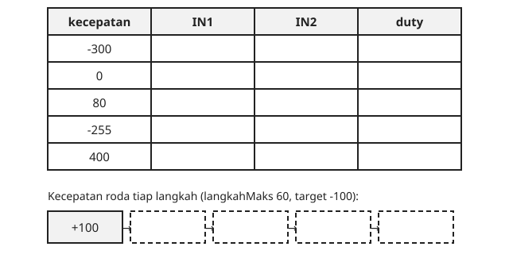

**Ingat dulu:** Tanpa melihat catatan, jawab. (1) Mengapa syarat wajib diperiksa lebih dulu daripada skor berbobot? ______ (2) Apa arti duty 50 persen pada PWM, dan mengapa LED tampak redup, bukan berkedip? ______



`[Gambar: tabel dengan kolom kecepatan, IN1, IN2, dan duty. Kolom kecepatan berisi -300, 0, 80, -255, dan 400, kolom lain kosong. Di bawahnya lima kotak berurutan untuk kecepatan roda: kotak pertama berisi +100 dan empat kotak lain kosong.]`

**Prediksi:** Tebak dulu, tulis jawabanmu, baru jalankan. `dariKecepatan(k)` menjepit `k` ke rentang -255 sampai 255, lalu menghasilkan `IN1`, `IN2`, dan `duty`: positif maju (`IN1` tinggi), negatif mundur (`IN2` tinggi), nol berhenti. `langkahKecepatan(sekarang, target, langkahMaks)` mendekati target paling banyak `langkahMaks` per langkah, tetapi bila tandanya berlawanan ia menuju 0 dulu. Isi tabel pada gambar. Berapa `langkahKecepatan(0, 200, 60)`? ______ Roda berputar maju pada +100 dan targetnya -100, `langkahMaks` 60: isi lima kotak kecepatan berturut-turut.

**Lengkapi:** Jepit ke rentang yang benar dan petakan arah ke pin. Isi bagian `____`.

```cpp setengah-jadi
// C++17. Lengkapi bagian ____.
Perintah dariKecepatan(int kecepatan) {
  int k = jepit(kecepatan, -____, KECEPATAN_MAKS);
  if (k > 0) {
    return {true, false, ____};
  }
  if (k < 0) {
    return {____, ____, -k};
  }
  return {false, false, 0};
}
```

**Susun:** Susun baris A sampai H menjadi fungsi `langkahKecepatan`. Dua baris `if` terakhir sebelum `return target` boleh bertukar.

```text
(A)   if (sekarang * target < 0) {
(B) int langkahKecepatan(int sekarang, int target, int langkahMaks) {
(C)     target = 0;
(D)   }
(E)   if (target > sekarang + langkahMaks) { return sekarang + langkahMaks; }
(F)   if (target < sekarang - langkahMaks) { return sekarang - langkahMaks; }
(G)   return target;
(H) }
```

Urutan: ______ ______ ______ ______ ______ ______ ______ ______

**Latihan:**

1. `AI: tanpa AI` Tulis `IN1`, `IN2`, dan `duty` untuk `dariKecepatan` dengan masukan 0, 80, -255, dan 400. ______
2. `AI: tanpa AI` Tulis pasangan (kiri, kanan) untuk putar kiri di tempat dan belok kanan landai, dengan kecepatan dasar 150. ______
3. `AI: boleh` Tulis pseudocode lalu tabel skenario robot maju-mundur-belok: pasangan (kiri, kanan) dan lama tiap langkah, tanpa kecepatan di atas 150 dan dengan jeda berhenti di antara arah yang berlawanan. ______

**Cek diri:**

- [ ] Saya dapat memetakan kecepatan bertanda ke pin arah dan duty.
- [ ] Saya membatasi perubahan kecepatan dan berhenti dulu sebelum membalik arah.
- [ ] Saya tahu aturan keselamatan untuk bagian yang bergerak.

**Catatan cetak (untuk guru, tidak dicetak):** dua halaman A4. Kunci ada di modul `c-xii1-m3`, bagian "Kunci dan petunjuk". Lembar tidak memuat kolom identitas.
