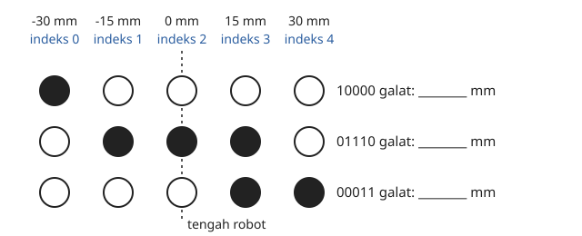

**Ingat dulu:** Tanpa melihat catatan, jawab. (1) Mengapa roda yang berlawanan arah tidak boleh dibalik seketika, dan apa yang dilakukan `langkahKecepatan`? ______ (2) Apa yang dilaporkan bila semua data satu kelompok hilang, dan mengapa tidak boleh dibagi dengan nol? ______



`[Gambar: lima lingkaran sensor sejajar pada posisi -30, -15, 0, 15, dan 30 mm dari tengah robot. Di bawahnya tiga baris pola: 10000, 01110, dan 00011, tempat 1 digambar sebagai lingkaran hitam penuh (gelap) dan 0 sebagai lingkaran kosong (terang). Di kanan tiap baris ada garis isian untuk galat.]`

**Prediksi:** Tebak dulu, tulis jawabanmu, baru jalankan. Sensor ke-4 (indeks 3) punya nilai putih 720 dan hitam 3500, sehingga ambangnya (720 + 3500) / 2 = 2110. Galat adalah rata-rata posisi sensor yang gelap, dipotong ke bilangan bulat. (1) Sensor itu membaca 2050. Gelap atau terang dengan ambang sendiri 2110? ______ Dan bila semua sensor memakai satu ambang bersama 1900? ______ (2) Berapa galat untuk pola `00110`, dan di sisi mana garisnya? ______ (3) Berapa galat bila pola `11111` dihitung seperti biasa, dan mengapa angka itu menyesatkan? ______

**Lengkapi:** Sensor dinyatakan gelap bila nilainya di atas ambangnya sendiri. Isi bagian `____`.

```cpp setengah-jadi
// C++17. Lengkapi bagian ____.
unsigned bitGelap(const Kalibrasi &k, const int baca[JUMLAH_SENSOR]) {
  unsigned bit = 0;
  for (int i = 0; i < JUMLAH_SENSOR; i++) {
    if (baca[i] ____ ambang(k, i)) {
      bit |= 1u << ____;
    }
  }
  return ____;
}
```

**Susun:** Susun baris A sampai J menjadi fungsi `masukkan`. Dua baris terakhir di luar `if` boleh bertukar.

```text
(A)     p.gagalBeruntun++;
(B) void masukkan(Pemantau &p, unsigned long mikrodetik) {
(C)   p.gagalBeruntun = 0;
(D)     return;
(E)   if (mikrodetik == 0) {
(F)     if (p.gagalBeruntun >= GAGAL_BERUNTUN_MAKS) { p.darurat = true; p.berhenti = true; }
(G)   }
(H)   p.darurat = false;
(I)   p.berhenti = haruBerhenti(p.berhenti, cmDariMikrodetik(mikrodetik));
(J) }
```

Urutan: ______ ______ ______ ______ ______ ______ ______ ______ ______ ______

**Latihan:**

1. `AI: tanpa AI` Dengan posisi -30, -15, 0, 15, 30, berapa galat untuk pola `10000`, `01110`, dan `00011`? Tulis pada gambar. ______
2. `AI: tanpa AI` Beri dua kemungkinan penyebab pola `11111`, dan tulis apa yang sebaiknya dilakukan robot. ______
3. `AI: boleh` Ubah batas berhenti menjadi 12 cm dan batas lanjut menjadi 18 cm. Prediksikan dulu apa yang berubah pada keluaran. ______

**Cek diri:**

- [ ] Saya menghitung ambang tiap sensor dari kalibrasi, bukan menebak.
- [ ] Saya dapat mengubah pola bit menjadi galat dan menyebut keterbatasannya.
- [ ] Saya tahu kalibrasi dilakukan dengan motor mati.

**Catatan cetak (untuk guru, tidak dicetak):** dua halaman A4. Kunci ada di modul `c-xii1-m4`, bagian "Kunci dan petunjuk". Lembar tidak memuat kolom identitas.
