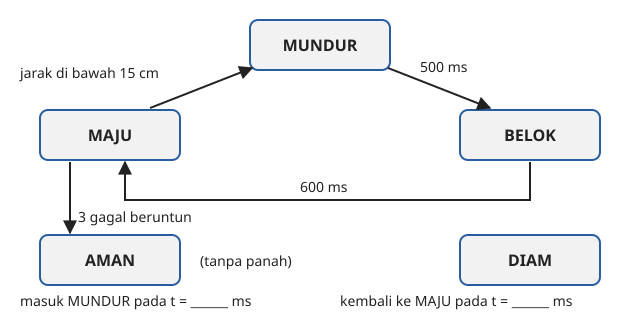

**Ingat dulu:** Tanpa melihat catatan, jawab. (1) Mengapa tiap sensor garis diberi ambang sendiri hasil kalibrasi, bukan satu ambang untuk semuanya? ______ (2) Sebut satu keadaan yang membuat garis tren menebak jauh meleset. ______



`[Gambar: diagram keadaan dengan kotak MAJU, MUNDUR, BELOK, AMAN, dan DIAM. Panah: MAJU ke MUNDUR berlabel "jarak di bawah 15 cm", MUNDUR ke BELOK berlabel "500 ms", BELOK ke MAJU berlabel "600 ms", MAJU ke AMAN berlabel "3 gagal beruntun". DIAM tanpa panah. Di bawah ada dua garis isian: kapan robot masuk MUNDUR dan kapan kembali ke MAJU.]`

**Prediksi:** Tebak dulu, tulis jawabanmu, baru jalankan. Mesin punya lima keadaan seperti pada gambar. Satu masukan datang tiap 100 ms; robot sudah di `MAJU`, dan jaraknya 40 cm pada t = 100 ms, lalu 14 cm pada t = 200 ms dan seterusnya. (1) Pada t berapa robot masuk `MUNDUR`? ______ (2) Pada t berapa robot kembali ke `MAJU`? ______ Tulis pada gambar. (3) Bila tiga pembacaan gagal beruntun terjadi di `MAJU`, apa yang dilakukan roda dan bagaimana robot keluar dari `AMAN`? ______

**Lengkapi:** Pada keadaan `MUNDUR`: pindah setelah lama habis (selisih waktu), ke keadaan yang benar, dan roda mundur tetap. Isi bagian `____`.

```cpp setengah-jadi
// C++17. Lengkapi bagian ____.
    case Keadaan::MUNDUR:
      if (in.sekarang ____ m.mulaiKeadaan >= LAMA_MUNDUR_MS) {
        pindah(m, Keadaan::____, in.sekarang);
        return {150, -150};
      }
      return {____, -120};
```

**Susun:** Susun baris A sampai I menjadi bagian `case Keadaan::MAJU` pada fungsi `langkah`.

```text
(A)       return {150, 150};
(B)     case Keadaan::MAJU:
(C)       } else {
(D)       if (!in.jarakValid) {
(E)         m.gagalBeruntun++;
(F)         if (m.gagalBeruntun >= GAGAL_BERUNTUN_MAKS) { pindah(m, Keadaan::AMAN, in.sekarang); return {0, 0}; }
(G)         m.gagalBeruntun = 0;
(H)         if (in.jarakCm < BATAS_HALANGAN_CM) { pindah(m, Keadaan::MUNDUR, in.sekarang); return {-120, -120}; }
(I)       }
```

Urutan: ______ ______ ______ ______ ______ ______ ______ ______ ______

**Latihan:**

1. `AI: tanpa AI` Pada kode contoh, apa yang terjadi bila sensor jarak gagal tiga kali beruntun saat robot berada di `MUNDUR`? Apa risikonya dan bagaimana perbaikannya? ______
2. `AI: tanpa AI` Tambahkan keadaan `JEDA` (200 ms berhenti) di antara `MUNDUR` dan `BELOK` agar roda tidak berbalik seketika. Tulis peralihan barunya. ______
3. `AI: boleh` Tulis pseudocode, lalu gambar diagram keadaan robot penghindar halangan versimu sendiri, dengan tabel keadaan, roda, dan syarat keluar. ______

**Cek diri:**

- [ ] Saya dapat menggambar diagram keadaan dan menulis tabel keadaan, roda, dan syarat keluar.
- [ ] Saya menghitung lama keadaan dengan selisih `millis()`, bukan `delay`.
- [ ] Saya merancang keadaan aman yang butuh tindakan manusia.

**Catatan cetak (untuk guru, tidak dicetak):** dua halaman A4. Kunci ada di modul `c-xii1-m5`, bagian "Kunci dan petunjuk". Lembar tidak memuat kolom identitas.
