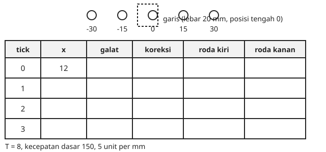

**Ingat dulu:** Tanpa melihat catatan, jawab. (1) Mengapa waktu pada mesin keadaan diperiksa dengan `sekarang - mulaiKeadaan >= lama`, bukan dengan `delay`? ______ (2) Pada robot dua roda, roda mana yang dibuat lebih lambat agar robot belok ke kiri? ______



`[Gambar: tabel penelusuran dengan baris tick 0, 1, 2, dan 3 dan kolom x, galat, koreksi, roda kiri, dan roda kanan. Hanya x pada tick 0 yang terisi 12; sel lain kosong. Di atas tabel tergambar lima sensor di -30, -15, 0, 15, dan 30 mm dan sebuah garis lebar 20 mm.]`

**Prediksi:** Tebak dulu, tulis jawabanmu, baru jalankan. `x` adalah posisi tengah robot terhadap tengah garis dalam mm (positif di kanan garis). Pada tiap tick, `x` baru sama dengan `x` ditambah geseran lintasan dikurangi **koreksi tick sebelumnya**. Sensor gelap bila garis (lebar 20 mm) berada di bawahnya. Galat adalah rata-rata posisi sensor gelap (dipotong), koreksi `T` = 8 positif untuk belok kiri, geseran awal 0, dan robot mulai di `x` = 12. (1) Pada tick 0, sensor mana yang gelap, berapa galatnya, dan berapa koreksi serta kecepatan roda (kecepatan dasar 150, 5 unit per mm)? ______ (2) Berapa `x` pada tick 1 dan tick 2? ______ (3) Pada tick 2 berapa koreksinya? ______ Mengapa `x` pada tick 3 tetap melewati garis ke sisi kiri? ______ Isi tabel pada gambar.

**Lengkapi:** Garis di kiri (galat negatif) berarti belok kiri, dan roda kiri melambat saat koreksi positif. Isi bagian `____`.

```cpp setengah-jadi
// C++17. Lengkapi bagian ____.
int hidupMati(int galat, int T) {
  if (galat ____ 0) { return T; }
  if (galat ____ 0) { return ____; }
  return 0;
}

void kecepatanRoda(int koreksi, int &kiri, int &kanan) {
  kiri = KECEPATAN_DASAR - ____ * koreksi;
  kanan = KECEPATAN_DASAR + UNIT_PER_MM * koreksi;
}
```

**Susun:** Susun baris A sampai I menjadi satu langkah keputusan pengikut garis.

```text
(A)   int galat = 0;
(B)   if (!hitungGalat(x, galat)) {
(C)     kendali(0, 0);
(D)     return;
(E)   }
(F)   int koreksi = hidupMati(galat, T);
(G)   kendali(KECEPATAN_DASAR - UNIT_PER_MM * koreksi, KECEPATAN_DASAR + UNIT_PER_MM * koreksi);
(H) void satuTick(int x) {
(I) }
```

Urutan: ______ ______ ______ ______ ______ ______ ______ ______ ______

**Latihan:**

1. `AI: tanpa AI` Untuk `T` = 5 dan `x` awal 12, tulis `x` pada tick 0 sampai 3 dan koreksi pada tick 0 sampai 3. ______
2. `AI: tanpa AI` Sebut tiga hal pada robot nyata yang tidak ada pada simulasi. ______
3. `AI: boleh` Tambahkan satu ukuran, misalnya tick pertama saat |x| tidak lebih dari 5, lalu rencanakan cara menjalankannya untuk `T` = 5, 8, dan 12. ______

**Cek diri:**

- [ ] Saya dapat menjelaskan kendali hidup-mati pada pengikut garis.
- [ ] Saya menulis fungsi keputusan yang murni dan menghubungkannya ke roda.
- [ ] Saya tidak menganggap hasil simulasi sebagai hasil robot.

**Catatan cetak (untuk guru, tidak dicetak):** dua halaman A4. Kunci ada di modul `c-xii1-m6`, bagian "Kunci dan petunjuk". Lembar tidak memuat kolom identitas.
