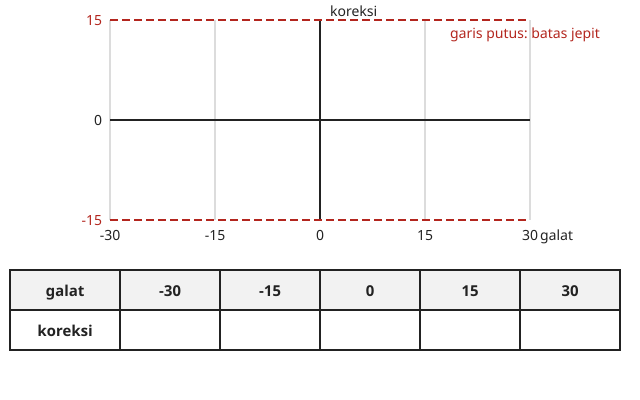

**Ingat dulu:** Tanpa melihat catatan, jawab. (1) Mengapa koreksi hidup-mati yang terlalu besar membuat robot sering berganti arah? ______ (2) Mengapa sistem perlu keadaan aman bila pesan sah berhenti datang? ______



`[Gambar: bidang grafik dengan sumbu mendatar galat dari -30 sampai 30 dan sumbu tegak koreksi dari -15 sampai 15. Dua garis putus-putus mendatar di koreksi 15 dan -15 menandai batas jepit. Di bawahnya tabel dengan lima kolom galat -30, -15, 0, 15, 30 dan baris koreksi kosong. Kamu mengisi tabel lalu menandai titiknya pada bidang.]`

**Prediksi:** Tebak dulu, tulis jawabanmu, baru telusuri. Fungsi `proporsional(galat, 3)` menghitung `-3 * galat / 4` dengan bilangan bulat (dipotong), lalu menjepit hasilnya ke -15 sampai 15. Jadi `Kp` = 3/4. (1) Berapa koreksi untuk galat -22, -7, 7, dan -15? ______ (2) Berapa koreksi untuk galat 0, dan mengapa pada robot nyata galat 0 sering terjadi pada rentang |x| yang kecil? ______ (3) Bila `Kp` dinaikkan menjadi 6/4 pada robot yang koreksinya baru terasa satu tick kemudian, menurutmu jumlah pergantian arah bertambah atau berkurang, dan mengapa? ______

**Lengkapi:** Kalikan dulu dengan galat, lalu jepit pada kedua ujung. Isi bagian `____`.

```cpp setengah-jadi
// C++17. Lengkapi bagian ____.
int proporsional(int galat, int pembilang) {
  int koreksi = -pembilang * ____ / PENYEBUT;
  if (koreksi > ____) { return KOREKSI_MAKS; }
  if (koreksi < ____) { return -KOREKSI_MAKS; }
  return koreksi;
}
```

**Susun:** Susun baris A sampai F menjadi inti perulangan `simulasi`. Perhatikan urutan dua baris yang memperbarui `x` dan `terdahulu`: urutan yang salah menghapus penundaan.

```text
(A)     x = x + GESER[t] - terdahulu;
(B)     if (hitungGalat(x, galat)) { koreksi = proporsional(galat, parameter); } else { h.hilang++; }
(C)     int koreksi = 0;
(D)     h.jejak[t] = x;
(E)     terdahulu = koreksi;
(F)     int galat = 0;
```

Urutan: ______ ______ ______ ______ ______ ______

**Latihan:**

1. `AI: tanpa AI` Berapa koreksi proporsional `Kp` = 3/4 untuk galat -30, -15, 0, 15, dan 30? Tulis pada gambar. ______
2. `AI: tanpa AI` Mengapa pergantian arah naik tajam pada `Kp` 4/4 ke atas? Jelaskan dengan penundaan satu tick. ______
3. `AI: boleh` Ubah `KOREKSI_MAKS` menjadi 6, prediksikan dulu pengaruhnya pada tikungan tajam. ______

**Cek diri:**

- [ ] Saya dapat menjelaskan kendali proporsional pada pengikut garis.
- [ ] Saya menulis koreksi dengan perkalian lebih dulu dan menjepitnya.
- [ ] Saya dapat menjelaskan ayunan akibat `Kp` besar dan koreksi tertunda.

**Catatan cetak (untuk guru, tidak dicetak):** dua halaman A4. Kunci ada di modul `c-xii1-m7`, bagian "Kunci dan petunjuk". Lembar tidak memuat kolom identitas.
