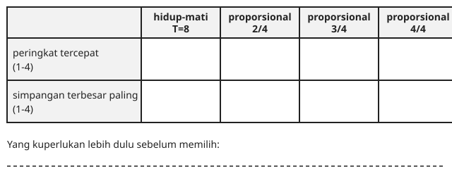

**Ingat dulu:** Tanpa melihat catatan, jawab. (1) Mengapa mengalikan dulu, baru membagi, pada `-pembilang * galat / penyebut`? ______ (2) Apa yang diukur oleh hitungan pergantian arah, dan apa yang ditunjukkan bila angkanya besar? ______



`[Gambar: tabel dengan empat kolom strategi: hidup-mati T=8, proporsional 2/4, proporsional 3/4, dan proporsional 4/4. Dua baris kosong: "peringkat tercepat (1 sampai 4)" dan "peringkat simpangan terbesar paling kecil (1 sampai 4)". Di bawahnya satu garis isian untuk apa yang kamu perlukan lebih dulu sebelum memilih.]`

**Prediksi:** Tebak dulu, tulis jawabanmu, baru jalankan. Robot harus menempuh 800 mm. Pada tiap tick robot maju 20 mm bila |x| paling banyak 10 mm (garis masih dekat), dan 10 mm bila lebih jauh; bila garis hilang robot berhenti. (1) Berapa tick paling sedikit yang mungkin, dan berapa tick bila robot selalu di laju lambat? ______ (2) Isi peringkat pada gambar menurut dugaanmu. (3) Bila kamu hanya boleh memilih satu, apa yang kamu perlukan lebih dulu sebelum menjawab: angka atau tujuan robotnya? ______

**Lengkapi:** Syarat wajib memakai batas yang diberikan, dan yang lebih sedikit tick-nya menang. Isi bagian `____`.

```cpp setengah-jadi
// C++17. Lengkapi bagian ____.
int pilih(const Ukuran *hasil, int jumlah, int maksBoleh) {
  int terbaik = -1;
  for (int i = 0; i < jumlah; i++) {
    if (!lolos(hasil[i], ____)) { continue; }
    if (terbaik < 0 || hasil[i].tickTempuh ____ hasil[terbaik].tickTempuh) { terbaik = ____; }
  }
  return terbaik;
}
```

**Susun:** Susun baris A sampai G menjadi inti perulangan `ukur`. Perhatikan: koreksi harus sudah dihitung sebelum disimpan sebagai `terdahulu`, dan `x` memakai `terdahulu` yang lama.

```text
(A)     u.tickTempuh = t + 1;
(B)     if (jarak >= PANJANG_LINTASAN) { u.selesai = true; }
(C)     bool ada = hitungGalat(x, galat);
(D)     x = x + geser - terdahulu;
(E)     terdahulu = koreksi;
(F)     if (ada) { koreksi = ...; jarak += ...; } else { u.hilang++; }
(G)     int geser = (t < TICK_GESER) ? GESER[t] : 0;
```

Urutan: ______ ______ ______ ______ ______ ______ ______

**Latihan:**

1. `AI: tanpa AI` Robot menempuh 800 mm; 30 tick pertama di laju cepat (20 mm per tick), sisanya di laju lambat (10 mm per tick). Berapa tick tempuhnya? ______
2. `AI: boleh` Ubah `KOREKSI_MAKS` menjadi 6, prediksikan dulu siapa pemenang pada batas simpangan 25 mm. ______
3. `AI: tanpa AI` Sebut apa yang kamu laporkan tentang batasan ujimu agar perbandingan dua strategi jujur. ______

**Cek diri:**

- [ ] Saya mengukur dua strategi pada lintasan dan kondisi awal yang sama.
- [ ] Saya menulis syarat wajib dan peringkat sebelum melihat hasil.
- [ ] Saya dapat menyebut apa yang membalik pilihan saya.

**Catatan cetak (untuk guru, tidak dicetak):** dua halaman A4. Kunci ada di modul `c-xii1-m8`, bagian "Kunci dan petunjuk". Lembar tidak memuat kolom identitas.
