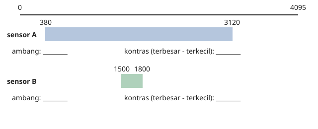

**Ingat dulu:** Tanpa melihat catatan, jawab. (1) Mengapa lintasan uji dan kondisi awal harus sama ketika dua strategi dibandingkan? ______ (2) Mengapa nilai terburuk, bukan rata-rata, yang dibandingkan dengan batas pada kebutuhan? ______ (3) Mengapa satu kali uji dari satu kondisi awal belum cukup untuk memilih strategi? ______



`[Gambar: skala mendatar 0 sampai 4095. Sensor A terbaca antara 380 dan 3120, sensor B antara 1500 dan 1800; tiap rentang digambar sebagai batang dengan nilai terkecil dan terbesar di ujungnya. Di samping tiap sensor ada dua kotak kosong: "ambang" dan "kontras (terbesar dikurangi terkecil)".]`

**Prediksi:** Tebak dulu, tulis jawabanmu, baru jalankan. Pada modul sebelumnya, hidup-mati `T` = 8 punya simpangan terbesar 13 mm dan proporsional 3/4 punya 20 mm, dari satu lari. Sekarang tiap strategi diuji sepuluh kali; titik awal (6 sampai 18 mm) dan derau geseran (-1, 0, atau 1 mm per tick) ditentukan oleh benih, dan tiap benih dipakai untuk **kedua** strategi. (1) Apakah hidup-mati masih punya simpangan terbesar yang lebih kecil, kira-kira berapa rata-ratanya, dan berapa terburuknya? ______ (2) Apakah selisih tick tempuh kedua strategi masih sekitar 2? ______ (3) Apa yang akan rusak bila kedua strategi memakai benih berbeda? ______

**Lengkapi:** `ringkas` menjumlahkan tick tiap percobaan, menyimpan yang terbesar, menghitung percobaan yang gagal, lalu membagi dengan banyak percobaan. Isi bagian `____`.

```cpp setengah-jadi
// C++17. Lengkapi bagian ____.
Ringkasan ringkas(const Hasil *h, int jumlah) {
  Ringkasan r = {0, 0, 0, 0, 0};
  int totalTick = 0;
  for (int i = 0; i < jumlah; i++) {
    totalTick += h[i].____;
    if (h[i].tick ____ r.terburukTick) { r.terburukTick = h[i].tick; }
    if (!h[i].selesai ____ h[i].hilang > 0) { r.gagal++; }
  }
  r.rataTick = totalTick / ____;
  return r;
}
```

**Susun:** Susun baris A sampai I menjadi kalibrasi satu sensor. Titik awal `terkecil` dan `terbesar` harus ditetapkan sebelum penyapuan.

```text
(A) int ambang = (terkecil + terbesar) / 2;
(B)   if (nilai > terbesar) { terbesar = nilai; }
(C) int terkecil = 4095;
(D) while (millis() - mulai < LAMA_SAPU_MS) {
(E)   int nilai = analogRead(PIN_SENSOR);
(F) }
(G) int terbesar = 0;
(H)   if (nilai < terkecil) { terkecil = nilai; }
(I) unsigned long mulai = millis();
```

Urutan: ______ ______ ______ ______ ______ ______ ______ ______ ______

**Latihan:**

1. `AI: tanpa AI` Satu sensor terbaca antara 380 dan 3120 selama penyapuan. Berapa ambangnya? ______ Sensor lain terbaca antara 1500 dan 1800; berapa ambangnya, dan apakah kontrasnya cukup untuk `KONTRAS_MIN` 400? Isi kotak pada gambar. ______
2. `AI: boleh` Ubah `JUMLAH_UJI` menjadi 30. Prediksikan dulu apakah nilai terburuk bisa turun. ______
3. `AI: tanpa AI` Tulis satu kalimat laporan yang jujur tentang batas kesimpulan dari sepuluh kali uji. ______

**Cek diri:**

- [ ] Saya mengalibrasi sensor dari nilai terkecil dan terbesar dan memeriksa kontrasnya.
- [ ] Saya menyimpan setiap percobaan, bukan hanya rata-rata.
- [ ] Saya menyatakan batas kesimpulanku: berapa kali uji dan apa yang belum diuji.

**Catatan cetak (untuk guru, tidak dicetak):** dua halaman A4. Kunci ada di modul `c-xii1-m9`, bagian "Kunci dan petunjuk". Lembar tidak memuat kolom identitas.
